<a id="top"></a>

# pogo

[](https://github.com/kobaw23214/pogo/actions/workflows/ci.yml)
[](https://goreportcard.com/report/github.com/kobaw23214/pogo)
[](LICENSE)
[](https://go.dev)

用 Go 与 Vue 构建的 Agent 工作台:每个 Agent 有真实的浏览器、真实的 Office 编辑、可编排的工作流与后台任务——全程可见、可审批、可回放。

<div align="center">
  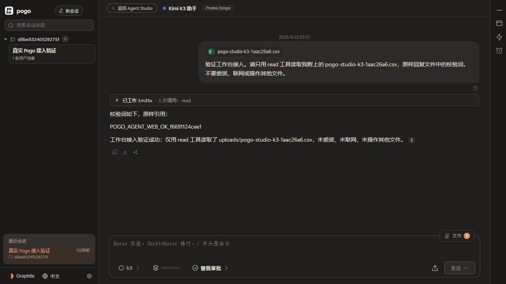
</div>

## 能力总览

| 能力 | 一句话 |
|---|---|
| [操作真实浏览器](#1-操作真实浏览器) | 每会话私有 Chromium,人与 Agent 同看一个页面,先审批后动手 |
| [编辑真实 Office 文档](#2-编辑真实-office-文档) | 在线 ONLYOFFICE 画布 + 两段式解析,没读到回执不许写 |
| [对话即富文档](#3-对话即富文档) | Mermaid / ECharts / 数学公式 / CSV 数据表,流式渲染 |
| [公共信息区与工作流](#4-公共信息区与-agent-工作流) | 跨 Agent 共享信息库;顺序 + DAG 工作流,版本快照启用制 |
| [Agent 管理与快捷方式](#5-agent-管理与嵌套快捷方式) | 模板创建、多模型、Skill/MCP 继承;快捷方式 5 层嵌套 |
| [Agent 自管 Skill](#6-agent-自己管理-skill) | 上传包 / 自著 / 运行时包,bubblewrap 沙箱执行 |
| [后台 Bash 与后台任务](#7-后台-bash-与后台任务) | 后台 shell / 后台子代理 / 定时与哨兵任务 / 持久终端 |
| [多模型接入](#8-多模型接入) | providers.json 单一配置源,工具协议自动降级 |

## 1. 操作真实浏览器

[browser-runtime](browser-runtime/) worker(Playwright + Wayland + WebRTC)为每个会话提供**私有 Chromium**:20+ 动作(snapshot/click/type/extract/batch/devtools…),页面按原始 URL 加载,无反代无 iframe。

- 人与 Agent **共看同一个 Page**:WebRTC 实时画面,随时接管/交还,共享登录态
- **先审批后动手**:首次页面操作弹审批卡,一轮一授权;子 Agent 无权自行开启
- **证据可溯源**:`dom-evidence-v1` 结构化证据(表格原始行列、跨行跨列,不展平),页面变了即拒绝;BigInt 精确核验数值(`0.1+0.2 = 0.3`)
- 网页下载自动入工作区,工作区文件可回传网页

## 2. 编辑真实 Office 文档

`office` skill 三层能力:`docs_office` 驱动 ONLYOFFICE 在线画布(用户所见即所得)→ `transform` 受控 Python 事务批量修改 → 未打开文件两段式解析(`info` 先取清单再按段取,首屏 token 降一个数量级)。

- **写入防盲改**:Word 写入须携带读取回执 `operationId`,Excel 须携带完整输入矩阵
- 编辑器**原生历史**撤销/重做,每文件 50 个版本可恢复
- 解析有防护:PDF 300MB 上限、扫描版不假装 OCR;docx 防解压炸弹;xlsx 流式只读,宏不执行

<div align="center">
  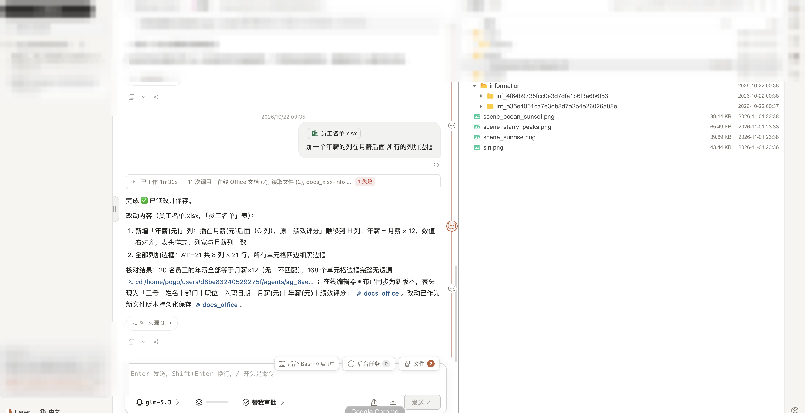
</div>

## 3. 对话即富文档

| 写法 | 渲染 |
|---|---|
| ` ```mermaid ` / ` ```echarts ` | Mermaid 11 全量图表 / ECharts 交互图表 |
| `$…$` / `$$…$$` / ` ```math ` | KaTeX 数学公式 |
| ` ```csv ` / ` ```json-table ` | 直接渲染成数据表 |
| ` ```diff ` / 多语言代码块 | 增删高亮 / 语法高亮 |
| `[TOC]` `[^1]` `- [x]` `> [!NOTE]` `:::` | 目录 / 脚注 / 任务列表 / callout / 折叠块 |
| `[文件](路径)` | 工作区文件卡片,点击内联预览 |

流式输出期间先显示代码,完成后自动成图。

<div align="center">
  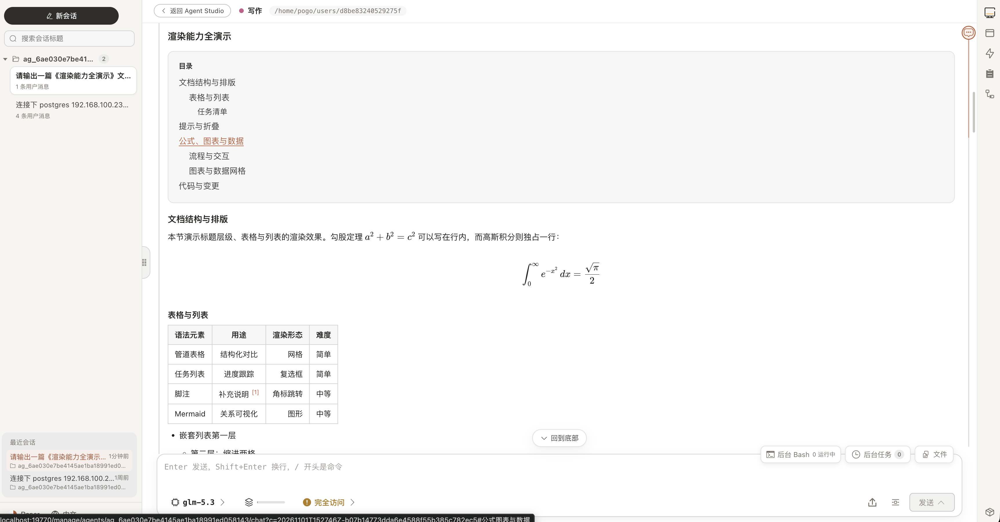
</div>
<div align="center">
  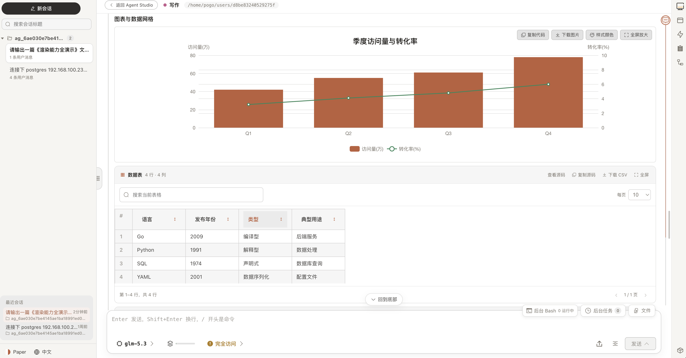
</div>

## 4. 公共信息区与 Agent 工作流

**信息库**是用户与 Agent 的共享事实源:文件、快捷方式、网页引用、Office 选区统一编目,同工作空间的**兄弟 Agent 看到同一份视图**(Agent 侧只读检索);外部系统经 `/panels/<名称>/` 反代接入右侧 hub 标签条。

<div align="center">
  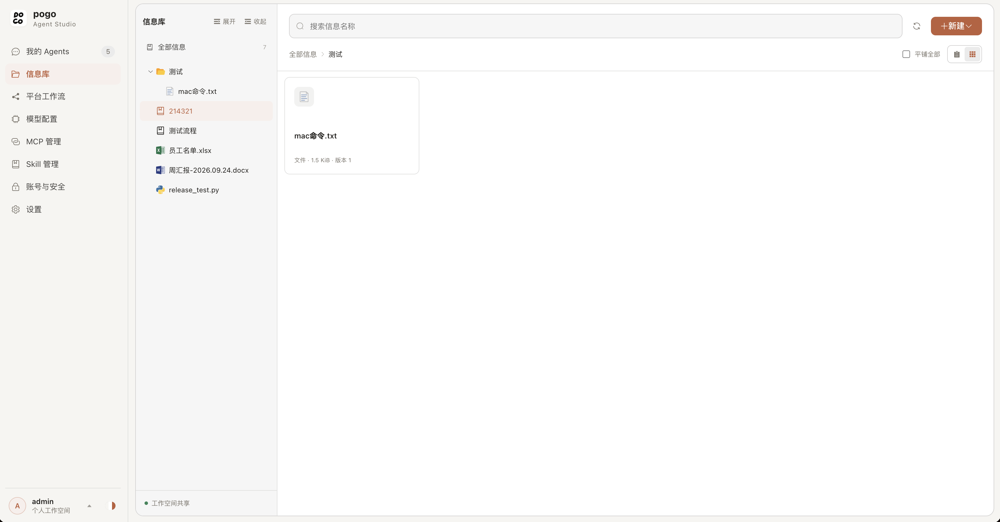
</div>

**工作流**:绑定单个 Agent 的可复用流程,顺序(agent/confirm/code/iteration/loop)与图(condition/parallel/join,静态校验无环+全可达)双形态。

- 输入按 SHA256 冻结、前序产物校验物化、Agent 配置指纹快照——变化即中断,不静默重跑
- SSE 每 500ms 推送全节点状态;Vue Flow 画布着色,每节点可打开执行会话看 Usage 环
- 「启用」存不可变版本快照,正式运行只执行 EnabledVersion;支持草稿试跑、单节点测试、链式重试
- Agent 在对话中用 `agent_workflow_read/edit/enable/run` 自管流程

<div align="center">
  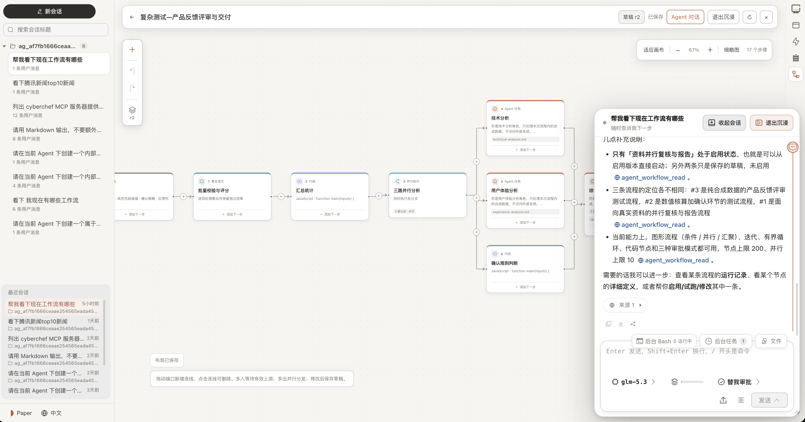
</div>

## 5. Agent 管理与嵌套快捷方式

<div align="center">
  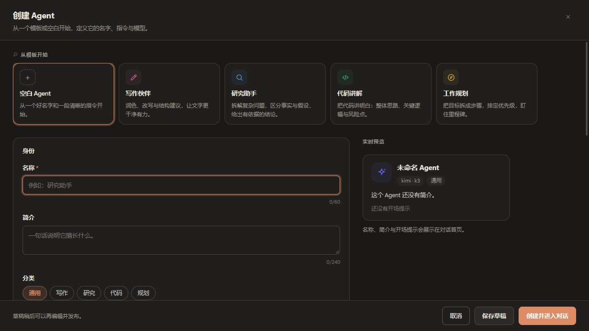
</div>

五个内置模板或空白起步,草稿 → 发布,发布后 `/a/{id}` 直达对话;一个 Agent 绑定多模型随时切换;Skill/MCP 按配置组合继承。

**快捷方式**是 Agent 私有的可复用资料包(文本/文件/Skill/网页元素/Office 选区/**嵌套快捷方式**),扁平 DAG、上限 5 层 512 节点、静态校验无环;首页起始卡是实时投影,编辑即时生效不留过期副本。

<div align="center">
  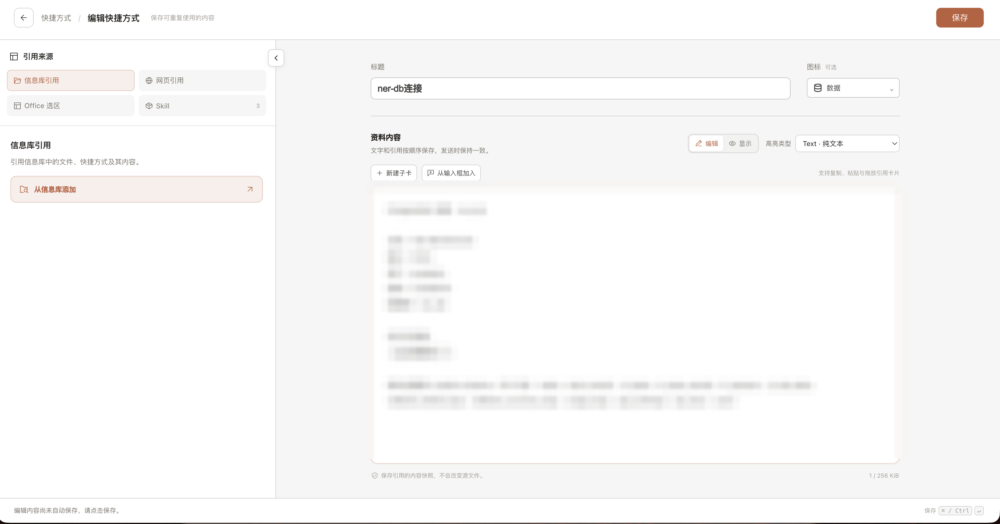
</div>
<div align="center">
  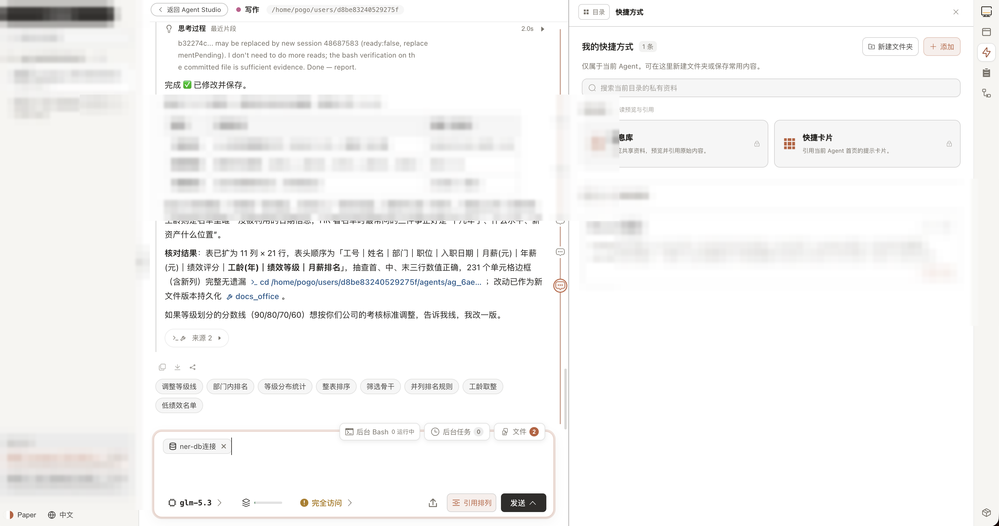
</div>

<div align="center">
  
</div>

## 6. Agent 自己管理 Skill

<div align="center">
  
</div>

三种形态:zip 上传包(防炸弹、热加载)/ Agent 对话中 `skill_save` **自著 Skill**(存私有目录,不混全局)/ 运行时可执行包(如恶意代码分析:CAPA/YARA/Ghidra)。

每个 capability 注册为**该会话的普通工具**,由 `pogo-skill-runner` 在 bubblewrap 沙箱短命执行:请求/响应双向 JSON Schema 门,超时/输出/内存/进程硬限,调用入监控。

<div align="center">
  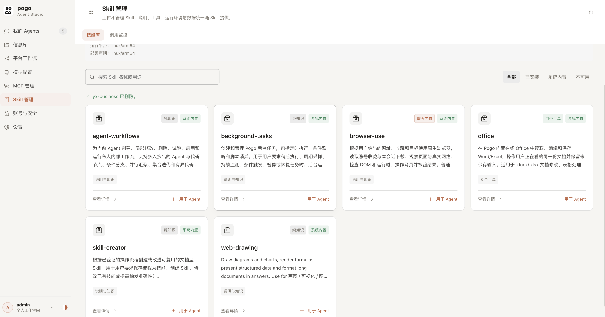
</div>

## 7. 后台 Bash 与后台任务

- **后台 shell**:`run_in_background` 立即返回任务 ID,按字节偏移续读输出,回执持久化、重启可恢复
- **后台子代理**:explore 默认后台,结果以通知送达并合并唤醒
- **宿主级任务**:cron/哨兵两类持久任务,不依赖会话存活;**创建默认暂停,启用需用户授权**
- **持久终端**:每会话 pty,关标签只是 detach,重连回放 backlog

<div align="center">
  
</div>

## 8. 多模型接入

单一 OpenAI 兼容客户端(支持 `reasoning_content` 等扩展字段),`providers.json` 唯一配置源、零内置 provider、密钥只走环境变量;不原生支持工具调用的模型自动降级 XML/JSON 文本协议。MCP 双向:接入外部工具服务,也可把 Agent 能力对外提供。

<div align="center">
  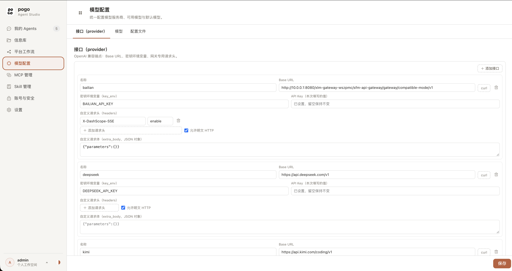
</div>
<div align="center">
  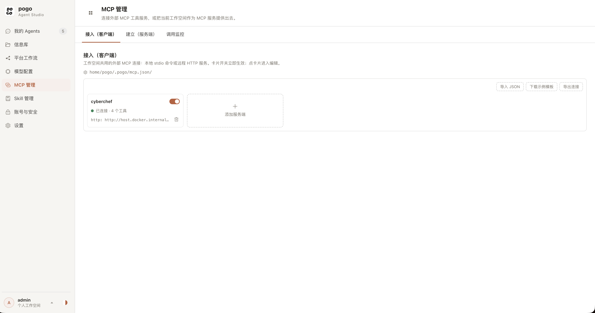
</div>

<div align="center">
  
</div>
<div align="center">
  
</div>

## 快速开始

```bash
go build -o pogo . && ./pogo -web -listen 127.0.0.1:7777   # 源码运行
docker compose up -d --build                                # Docker,http://127.0.0.1:19777
```

首次启动需要 `~/.pogo/providers.json`(缺省会报最小示例);浏览器能力另起 `compose.browser.yml`。平台现状见 [docs/project-status.md](docs/project-status.md)。

<div align="center">
  
</div>

## 界面一览

| | |
|---|---|
|  |  |
|  | 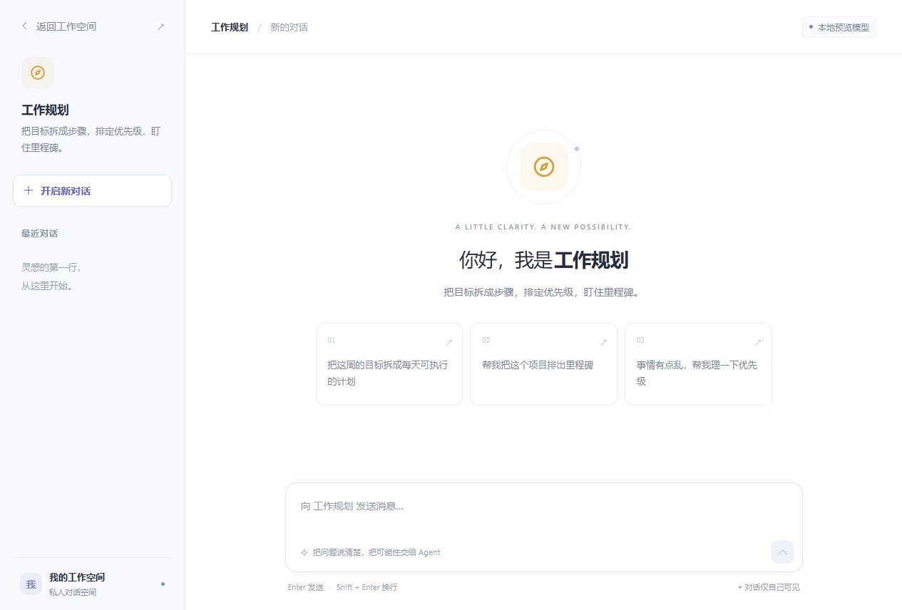 |
|  |  |
| 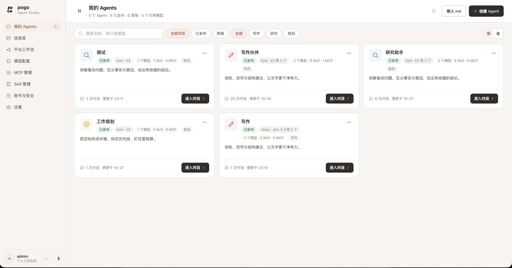 | 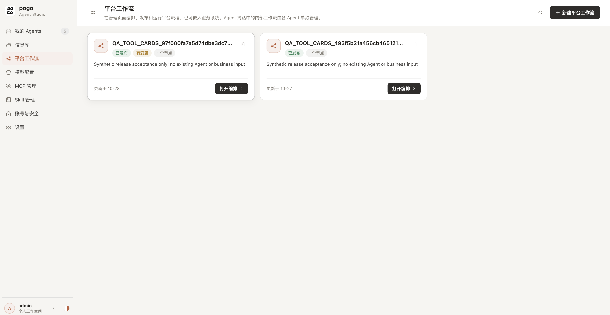 |
| 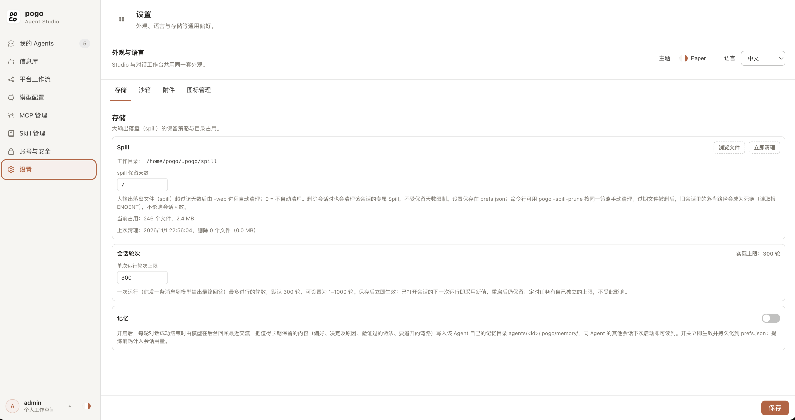 | 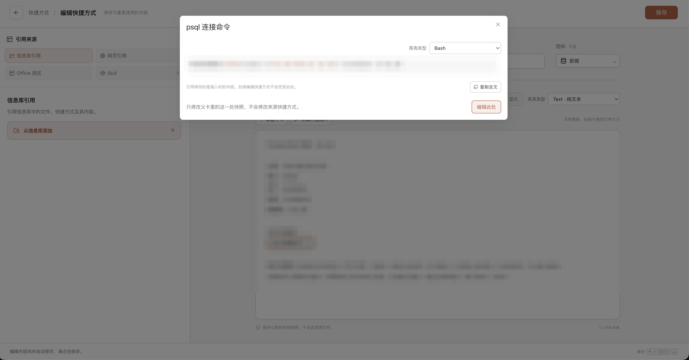 |
| 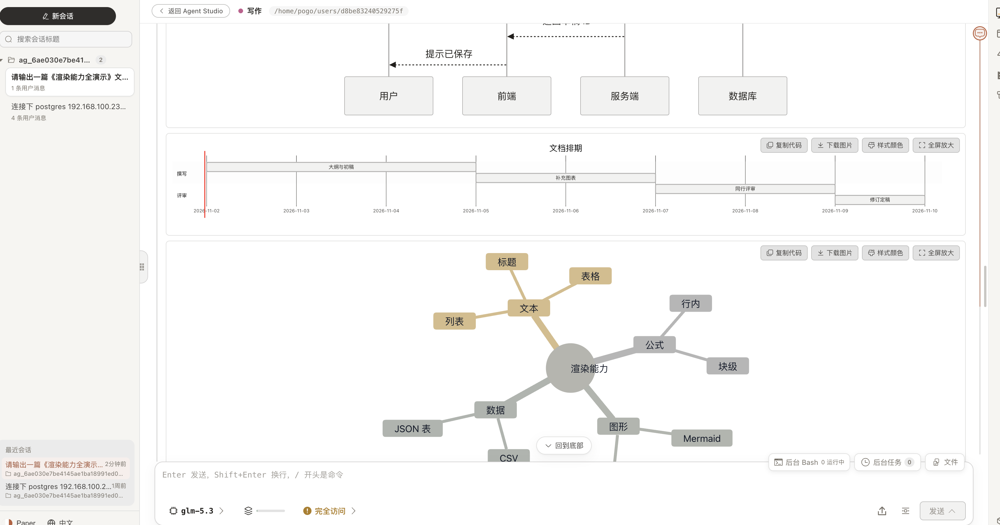 | 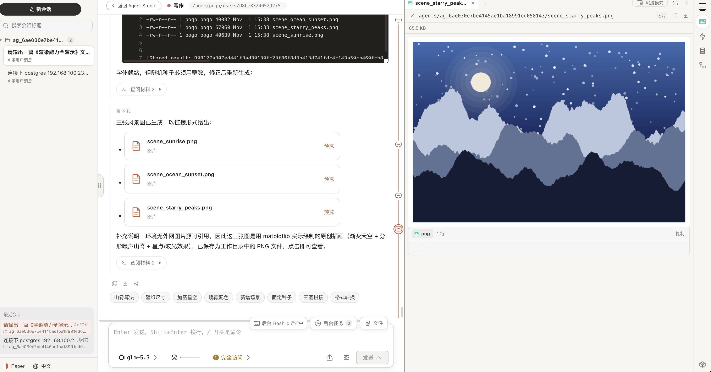 |

## 联系方式

<div align="center">

**微信扫码交流 / Scan to chat on WeChat**


**邮箱 / Email**: [1477746214@qq.com](mailto:1477746214@qq.com)

Bug 反馈与功能建议:[提个 Issue](https://github.com/kobaw23214/pogo/issues)

</div>

更多设计文档见 [docs/](docs/)。License 见 [LICENSE](LICENSE)。
