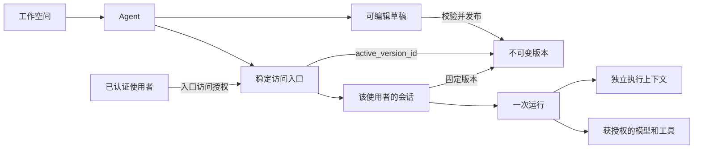

# Pogo Agent 管理平台调研与改造建议

> 这是 2026-09-22 的调研与建议，不是当前功能清单。Agent Studio、Skill Runtime 和工作流已有后续实现，范围与缺口见 [项目现状](project-status.md)。

调研日期：2026-09-22。改造对象：DiscoverAgent 中的 Pogo 服务及其 Web UI。本文是设计调研报告，未实施平台改造。

## 1. 建议结论

**建议按“配置和发布 Agent 的管理平台”改造：`/manage` 管理 Agent，`/a/{public_id}` 使用已发布的 Agent，Pogo 继续承担运行引擎。** 先交付多个独立 Agent 的配置、发布、访问、隔离和追踪闭环，再扩展工作流画布、开放平台和多租户运营。

用户提出的“配置完成后得到一个 Agent 链接”适合作为主产品流程。实现时需要明确三个对象：

1. **Agent**：可复用的能力配置，例如“IOC 研究助手”“样本分析助手”。
2. **发布版本与访问入口**：对外服务的是哪个配置版本、允许谁使用。
3. **会话与运行**：某个使用者和某个 Agent 的私有交互，以及每一次实际执行。

一个 Agent 可以服务很多用户、拥有很多会话。创建 Agent 不应创建用户账号；获得访问链接也不应获得管理权限或其他人的历史会话。

建议组合借鉴：Dify 的配置与发布体验、LangSmith 的独立配置及版本管理、Copilot Studio 的作者与使用者权限区分，以及当前 OpenAI Agents API 对 Agent、环境和会话的划分。这里是**对本项目的设计判断**，不是各厂商共同遵循的一份强制标准。

## 2. 范围、事实口径与暂定前提

- **本次目标**：调研主流平台的实际做法，核对本地源码，提出新平台方案、迁移边界和验收标准。
- **暂定第一阶段**：内部团队使用；管理员或获授权的编辑者配置 Agent，普通成员登录访问。使用人群尚待用户确认；多客户租户和公开匿名访问的增量见第 12 节。
- **旧约定的处理**：依据本次用户指示，旧自动开户、旧接入协议以及旧页面组织方式都允许废弃。保留哪些底层能力，由新平台目标决定。现有历史数据的归属需要显式处理，不能靠猜测补全。
- **“SOTA”的范围**：选择六类有代表性的产品/运行平台，比较与本需求直接相关的管理、发布、权限、版本和运行能力；不做模型能力排名，也不宣称市场份额或性能领先。
- **证据等级**：外部事实来自本次打开的官方文档或官方仓库；本地事实来自当前工作区的源码静态检查。本文没有登录试用这些 SaaS、执行供应商隔离测试或进行生产压测。
- **版本边界**：Dify Cloud、Dify Enterprise、Coze Studio 社区版、Flowise Cloud/Enterprise、LangSmith Deployment 的能力不能互相替代。未查证的能力不记为“没有”。

## 3. 主流平台实际上怎么做

### 3.1 六组样本对照

| 平台与观察范围 | 与本需求直接相关的官方事实 | 最值得借鉴 | 需要明确的边界 |
|---|---|---|---|
| **Dify Cloud / Enterprise** | 发布应用可获得 Web App URL，也支持 API、网页嵌入和 MCP 等入口。Enterprise 3.12.x 提供指定成员、平台成员、外部 SSO 用户、任何人四类 Web 访问策略。 | 配置 → 调试 → 发布 → 复制链接；访问策略作为发布配置。 | 四类访问策略的证据来自 Enterprise；不能据此宣称社区版具有同样权限。Web 权限和 API key 权限分开。见 [D1](https://docs.dify.ai/en/cloud/use-dify/publish/README)、[D2](https://enterprise-docs.dify.ai/en/3.12.x/use/publish/webapp/web-app-access)。 |
| **Coze Studio 社区版** | 官方仓库列出 Agent 构建/发布/管理、工作流、知识库、插件，以及 OpenAPI / Chat SDK；社区版 API / SDK 使用 PAT。 | Agent、可复用资源、会话分别建模；发布后可从多个渠道消费。 | 社区版与商业版存在差异；本次未核实商业版完整 RBAC、企业 SSO 或所有发布渠道。见 [C1](https://github.com/coze-dev/coze-studio)、[C2](https://github.com/coze-dev/coze-studio/wiki/6.-API-Reference)。 |
| **Flowise** | 可嵌入聊天组件；flow 默认可凭 ID 经 Embed/API 调用，可绑定 API key；工作空间及 RBAC 文档标注 Cloud/Enterprise。 | 资源统一登记、工作空间组织、对同一资源实施 UI/API 权限。 | 默认公开的 flow 策略不适合作为本平台内部 Agent 的默认值；不能把商业工作空间能力当作所有自托管安装的默认能力。见 [F1](https://docs.flowiseai.com/configuration/authorization/chatflow-level)、[F2](https://docs.flowiseai.com/using-flowise/workspaces)、[F3](https://docs.flowiseai.com/using-flowise/embed)。 |
| **LangSmith Deployment / Agent Server** | Assistant 将 prompt、模型和工具配置与 graph 分开；同一个 graph 可配置多个 Assistant；配置有版本，可切换 active 版本。 | 一套 Pogo 引擎承载多个 Agent；配置版本独立于运行代码。 | Assistant 是 Deployment/Agent Server 概念，不是安装开源 LangGraph 库就获得的管理平台。见 [L1](https://docs.langchain.com/langsmith/assistants)、[L2](https://docs.langchain.com/langsmith/configuration-cloud)。 |
| **Microsoft Copilot Studio** | 标准 harness 文档区分编写时测试、发布、多渠道接入；允许分别授予聊天和协作编写权限。 | 作者与使用者分离；测试与生产分离；连接外部系统时明确凭据属于谁。 | Demo website 明确不用于生产；本文不把 standard harness 文档的语义推广到其所有新体验。见 [M1](https://learn.microsoft.com/en-us/microsoft-copilot-studio/publication-fundamentals-publish-channels?tabs=web)、[M2](https://learn.microsoft.com/en-us/microsoft-copilot-studio/publication-connect-bot-to-web-channels)、[M3](https://learn.microsoft.com/en-us/microsoft-copilot-studio/admin-share-bots?tabs=teams)。 |
| **OpenAI Agents API / ChatKit** | Agents API 分开 Agent、Environment、Session、Events；保存的 Agent 可按 ID 创建会话。ChatKit 支持自建后端。 | 配置对象与会话、执行环境解耦；聊天 UI 与服务端运行机制解耦。 | 属于 API/SDK 组件，不能直接等同于现成的自托管 `/manage` 平台；OpenAI 托管运行与本地 Pogo 的部署边界不同。见 [O1](https://developers.openai.com/api/docs/guides/agents-api/overview)、[O2](https://developers.openai.com/api/docs/guides/agents-api/configuration)、[O3](https://developers.openai.com/api/docs/guides/chatkit)。 |

### 3.2 四个容易被旧资料或产品演示误导的细节

**第一，Agent Builder 已进入退役期。** OpenAI 在 2026-06-03 宣布弃用 Agent Builder，计划在 2026-11-30 关闭；ChatKit 继续可用。Agent Builder 的“发布生成配置快照”可以作为历史设计参考，但不应成为本项目的新技术依赖。当前官方给出的迁移方向包括 Agents SDK 或 ChatGPT Workspace Agents；自建 ChatKit 应连接自己的服务端。[O4：官方退役时间表](https://developers.openai.com/api/docs/deprecations)、[O5：Agent Builder 文档](https://developers.openai.com/api/docs/guides/agent-builder)、[O6：自建 ChatKit](https://developers.openai.com/api/docs/guides/custom-chatkit)。

**第二，发布更新并没有统一的会话语义。**

| 官方文档所描述的行为 | 本项目的判断 |
|---|---|
| Dify 发布会用当前配置替换 live app，后续交互看到更新。[D1](https://docs.dify.ai/en/cloud/use-dify/publish/README) | 体验简单，但不能据此认为旧会话一定固定旧配置。 |
| LangSmith Assistant 可以切换 active version；更新 API 要提供完整配置，不与旧配置自动合并。[L2](https://docs.langchain.com/langsmith/configuration-cloud) | 配置快照和 active 指针值得借鉴；部分字段编辑与整版发布需在我们自己的 API 中区分。 |
| Copilot Studio 标准 harness 通常在新会话使用最新发布内容；持久会话渠道有额外生效说明。[M1](https://learn.microsoft.com/en-us/microsoft-copilot-studio/publication-fundamentals-publish-channels?tabs=web) | 适合参考“已有会话不突然换行为”，不能把渠道特例写成本平台承诺。 |
| OpenAI 保存的 Agent 在创建 Session 时复制配置；后续更新 Agent 只影响新 Session，现存 Session 可单独更新。[O2](https://developers.openai.com/api/docs/guides/agents-api/configuration) | 本项目建议默认固定会话版本，并记录每次 Run 的实际配置；升级需要明确操作。 |

**第三，能编辑 Agent、能使用 Agent、能查看用户对话是不同权限。** Dify Enterprise 文档明确：某些编辑角色仍需加入访问名单才能使用已发布 Web App；Copilot Studio 则允许协作者聊天，且分析和逐条会话记录另有权限。两家的具体规则并不一致。我们应明确自己的规则，不能把“管理员能配置”自动扩大成“管理员能读取全部私人内容”。[D2](https://enterprise-docs.dify.ai/en/3.12.x/use/publish/webapp/web-app-access)、[M3](https://learn.microsoft.com/en-us/microsoft-copilot-studio/admin-share-bots?tabs=teams)。

**第四，管理页登录不等于运行接口已受保护。** Flowise 的 flow API key 与管理组织角色是不同层面的设置；LangSmith 文档也区分认证与每个资源上的授权，自托管服务需要自行实现认证。新平台必须对会话、SSE、附件、工具执行都验证实际权限，不能只在 Vue 路由中隐藏按钮。[F1](https://docs.flowiseai.com/configuration/authorization/chatflow-level)、[F2](https://docs.flowiseai.com/using-flowise/workspaces)、[L3](https://docs.langchain.com/langsmith/auth)。

### 3.3 对本项目有用的共同方向

从上述材料可以推导出值得采用的方向：**管理入口、配置资产、发布入口、用户会话、运行记录分别建模，同时通过 ID 和权限关联。** 这比复制某个平台的页面布局更重要。

另一个可借鉴方向是“日志 → 问题样例 → 回归评估”。Dify 可以查看会话/运行日志及工具或节点轨迹；LangSmith 将离线数据集评估与线上评估区分，并支持把失败 trace 纳入后续测试。本项目第一阶段应有运行记录和小型回归集，不需要立即开发完整评测平台。[D3](https://docs.dify.ai/en/cloud/use-dify/monitor/logs)、[L4](https://docs.langchain.com/langsmith/evaluation)。

## 4. 当前 Pogo 的事实与改造落点

**当前代码已经是带用户归属和丰富工具能力的会话工作台，但还没有本次需要的 Agent 配置与发布对象。** 不能直接把一个现有 Session 改名为 Agent，也不能靠给现有页面增加一个 `/manage` 路径就完成平台化。

下表依据 2026-09-22 当前工作区源码。目录存在大量既有未提交改动，因此以工作区文件为准，不以仓库旧 README 或历史版本为准；行号是本次检查时的位置。

| 当前核实的事实 | 源码证据 | 对新平台的影响 |
|---|---|---|
| **没有独立的 `/manage` 页面分支。** 根组件只识别 `/share/`，其余进入 `AgentView`；服务端未知路径回退 SPA。 | [App.vue:18](C:/Users/14777/Desktop/Pjt_Personal/DiscoverAgent-20260821/pogo/web/ui/src/App.vue:18)、[ui.go:42](C:/Users/14777/Desktop/Pjt_Personal/DiscoverAgent-20260821/pogo/web/ui.go:42) | `/manage` 现在即使能打开，也不代表管理平台存在；需要实际前端路由和对应管理 API。 |
| 创建会话接口接收 `model`、`workspace`，再结合请求身份调用 `CreateAs`；没有按已发布 Agent 解析配置。 | [server.go:1182](C:/Users/14777/Desktop/Pjt_Personal/DiscoverAgent-20260821/pogo/web/server.go:1182)、[manager.go:950](C:/Users/14777/Desktop/Pjt_Personal/DiscoverAgent-20260821/pogo/web/manager.go:950) | 新入口应由服务端选择发布版本和能力上限，不能把现有会话参数直接当 Agent 配置。 |
| **自动开户确实存在，但有条件。** 密码登录发现用户名不存在时调用 `provision`；必须提供有效 admin 密码或部署 token，并验证新用户名/密码；创建的是普通账号。 | [auth.go:493](C:/Users/14777/Desktop/Pjt_Personal/DiscoverAgent-20260821/pogo/web/auth.go:493)、[auth.go:543](C:/Users/14777/Desktop/Pjt_Personal/DiscoverAgent-20260821/pogo/web/auth.go:543) | 应把这种携带运维凭据的首次登录开户移出普通登录，改为明确成员管理。不能误述为任何匿名访客都能注册。 |
| 现有改密逻辑还支持管理员或 `admin_password` 给普通账号改密，用作外部系统密码同步。 | [auth.go:615](C:/Users/14777/Desktop/Pjt_Personal/DiscoverAgent-20260821/pogo/web/auth.go:615) | 与旧业务接入有关的密码同步约定也要明确退役或改成受限管理接口。 |
| **当前身份开关是 `POGO_IDENTITY_CONFIG` / `POGO_USERS_FILE`。** 两者之一启用时建立归属目录；当前入口没有历史 `POGO_DELEGATED_CONFIG` 的独立服务分支。 | [serve.go:97](C:/Users/14777/Desktop/Pjt_Personal/DiscoverAgent-20260821/pogo/serve.go:97)、[server.go:289](C:/Users/14777/Desktop/Pjt_Personal/DiscoverAgent-20260821/pogo/web/server.go:289) | 不能按旧的“私有 `/v1` 纯文本子系统”假设设计迁移；本次范围检索也未发现历史 `web/delegated.go`、`web/conversation.go` 文件。 |
| 当前 `authenticate` 依次尝试委托 JWT、固定 token、密码 Cookie；多用户模式下部署 token 可映射为默认 admin。 | [server.go:625](C:/Users/14777/Desktop/Pjt_Personal/DiscoverAgent-20260821/pogo/web/server.go:625) | 部分注释说“共享 token 通道关闭”，但实现保留了 token → admin 映射；新平台认证应按实现重审，不能照注释认定旧 token 已完全禁用。 |
| 配置、MCP 编辑、Skill 上传、调度等已有 `s.admin(...)` 门槛；会话查询另有 scope 归属检查。 | [server.go:315](C:/Users/14777/Desktop/Pjt_Personal/DiscoverAgent-20260821/pogo/web/server.go:315)、[server.go:678](C:/Users/14777/Desktop/Pjt_Personal/DiscoverAgent-20260821/pogo/web/server.go:678)、[server.go:1758](C:/Users/14777/Desktop/Pjt_Personal/DiscoverAgent-20260821/pogo/web/server.go:1758) | 可复用部分授权骨架，但需新增工作空间和每个 Agent 的动作权限。 |
| 归属目录的 `Session` 记录含 ID、Scope、标题、状态、时间；Scope 是 app/tenant/subject/project，尚未表达 Agent/发布版本。 | [catalog.go:50](C:/Users/14777/Desktop/Pjt_Personal/DiscoverAgent-20260821/pogo/catalog/catalog.go:50)、[identity.go:64](C:/Users/14777/Desktop/Pjt_Personal/DiscoverAgent-20260821/pogo/identity/identity.go:64) | 会话归属模型必须增加平台 Agent、入口和版本关联；不把上游 app/project 直接等同于 Agent。 |
| 工作目录按 owner 的 SubjectID 派生并按需建立；工作空间记忆、journal、checkpoint 也是按 owner root 分组。 | [manager.go:1033](C:/Users/14777/Desktop/Pjt_Personal/DiscoverAgent-20260821/pogo/web/manager.go:1033)、[manager.go:1084](C:/Users/14777/Desktop/Pjt_Personal/DiscoverAgent-20260821/pogo/web/manager.go:1084) | 这是用户维度的现有分区；新平台还要定义同一用户不同 Agent 的记忆、文件和状态是否隔离，目录分区不能当作完整执行沙箱。 |
| MCP 基础配置共享；有个人 token override 的 owner 使用独立池，没有 override 时回到共享池；每次新运行有 MCP 刷新机制。 | [manager.go:669](C:/Users/14777/Desktop/Pjt_Personal/DiscoverAgent-20260821/pogo/web/manager.go:669)、[mcprefresh.go:13](C:/Users/14777/Desktop/Pjt_Personal/DiscoverAgent-20260821/pogo/web/mcprefresh.go:13) | 需要将隐式共享连接改为明确的服务连接/用户连接授权，并增加 Agent 能力过滤。 |
| Skill 启动发现以整个服务为单位；创建 Session 时从 Manager 装配模型、Skill、工具、MCP、审批和 owner 工作区。 | [serve.go:135](C:/Users/14777/Desktop/Pjt_Personal/DiscoverAgent-20260821/pogo/serve.go:135)、[manager.go:1392](C:/Users/14777/Desktop/Pjt_Personal/DiscoverAgent-20260821/pogo/web/manager.go:1392) | `newSession` 是新运行配置解析的重要落点；需要接受解析后的 AgentVersion 和执行上下文。 |
| **`/share/{id}` 是已发生的一轮问答快照。** 包含消息与工具结果；公开 GET 获取快照；代码明确没有撤销 API。 | [share.go:3](C:/Users/14777/Desktop/Pjt_Personal/DiscoverAgent-20260821/pogo/web/share.go:3)、[share.go:149](C:/Users/14777/Desktop/Pjt_Personal/DiscoverAgent-20260821/pogo/web/share.go:149)、[server.go:368](C:/Users/14777/Desktop/Pjt_Personal/DiscoverAgent-20260821/pogo/web/server.go:368) | 无法复用为“可发起新对话的 Agent 链接”；如保留分享，应补独立访问、有效期和撤销语义。 |

在上述入口、存储和 UI 范围内，未发现 `AgentVersion` / `Deployment` 等管理实体。现有 `agent.Agent` 是执行循环对象，不等于可持久管理、发布的产品 Agent。当前具有授权和分区机制，也**不代表本次已经证明所有工具、终端或文件访问都满足新平台的多 Agent 隔离**。

建议改动边界：新增 Agent/版本/入口/连接绑定存储与服务；替换旧登录开户流程；在 `Server` 增加管理及应用入口；在 `Manager.newSession` 前加入发布配置解析；为前端增加真正的路由与管理视图。引擎循环、SSE、审批、文件产物和观测能力按新的作用域合同逐项复用。

## 5. 新平台的页面和主流程

### 5.1 路由与信息结构（建议）

| 路由 | 使用者 | 页面职责 |
|---|---|---|
| `/manage` | 平台管理者、获授权的编辑者 | Agent 列表：草稿、已发布、存在未发布改动、停用状态；创建、复制、编辑。 |
| `/manage/agents/{agent_id}` | 有该 Agent 编辑权限的人 | 配置、预览、版本、发布、访问范围、运行记录。 |
| `/manage/connections` | 管理者或连接管理者 | 模型供应商、MCP/业务连接和凭据引用；授权哪些 Agent 使用。 |
| `/manage/members` | 管理者 | 邀请、禁用成员，设置管理角色和 Agent 使用范围。 |
| `/agents` | 已登录成员 | 我可以使用的 Agent，可选目录入口。 |
| `/a/{public_id}` | 通过该入口访问策略的用户 | 某个已发布 Agent 的交互页，只展示能力说明、输入、自己的会话和产物。 |
| `/a/{public_id}/c/{conversation_id}` | 会话所有者或显式获授权者 | 恢复该 Agent 下的一段对话；逐请求检查归属。 |
| `/share/{share_id}` | 符合分享策略的人 | 可选的会话/产物分享页，与 Agent 入口分开。 |

`public_id` 是稳定的发布入口标识，**不是访问口令**。改 Agent 名称不改变链接；复制 Agent 产生新 ID、新链接；第一次发布才启用正式入口。内部用户把链接转发给无权限成员时，后端仍拒绝使用。

### 5.2 管理者的主流程

1. 在 `/manage` 点击“创建 Agent”，填写名称、描述，选择基础模板。
2. 配置指令、模型、已授权工具、知识资源、会话行为和运行限制。
3. 在预览区测试。预览使用草稿快照，记录为测试运行，不进入生产会话列表。
4. 点击“发布”，检查模型/连接可用、工具权限、访问范围和必要的回归结果。
5. 发布成功，得到稳定链接；可选择打开页面或复制链接。
6. 后续修改自动保存到草稿；显示“有未发布改动”。再次发布、回滚或停用都记录操作者与时间。

### 5.3 Agent 应能配置什么

| 配置组 | 第一阶段建议内容 | 需要避免的耦合 |
|---|---|---|
| 基本信息 | 名称、图标、描述、欢迎语、示例问题 | 名称和 URL/数据库主键分开。 |
| 指令 | 系统指令、任务边界、输入/输出要求 | 不让普通访问者覆盖系统指令。 |
| 模型 | 供应商连接、真实模型 ID、推理档、上下文和输出限制 | 连接凭据独立管理，配置只存引用。 |
| 工具/Skills | 允许的 MCP 工具或工具组、已审核 Skill 版本、审批策略 | 管理者授权的能力不会因为动态发现而自动扩大。 |
| 知识和记忆 | 已授权数据源；是否启用个人跨会话记忆 | 公共知识、个人记忆、会话上下文各自有作用域。 |
| 运行 | 超时、轮次、并发、额度、是否允许后台执行 | 达到限制时明确停止或排队，不默默换模型。 |
| 访问与发布 | 私有测试/指定成员/工作空间成员；版本、发布说明 | 正式访问策略与草稿配置分开管理，撤权及时生效。 |

关于用户此前要求的最高推理深度：本项目可以把 **Kimi K3 / GLM-5.3 的默认策略设为 `max`**。平台适配器须把这个策略映射到对应供应商实际支持的参数，记录用户要求、实际下发参数及供应商回执；供应商未回报的内部执行档位应标记为未验证，不能声称已证实。不支持时在测试/发布检查中报明原因，不能静默降档。CLI Worker 的参数已配置，不等于 Pogo 的模型适配器已经支持相同参数；这是后续实施必须核验的适配项。

## 6. 核心对象：明确分开 Agent、版本、入口和会话

以下是本项目建议的数据合同，不是照抄某家厂商的表结构。

| 对象 | 核心字段/关联 | 为什么需要 |
|---|---|---|
| Workspace | `id`, `name` | 资源管理边界。第一阶段可只有一个工作空间，但不把 ID 省掉。 |
| Principal / Membership | 平台用户或服务主体；`workspace_id`, `role`, `status` | 同一个身份可以被明确授予工作空间角色；不把用户名当永久主键。 |
| Agent | `id`, `workspace_id`, `name`, `created_by`, `status` | Agent 是工作空间资产；创建者不是所有访问者共同使用的运行身份。 |
| AgentDraft | `agent_id`, `revision`, `config` | 可修改草稿，使用修订号防止多人互相覆盖。 |
| AgentVersion | `id`, `agent_id`, `config_snapshot`, `config_hash`, `created_by` | 不可变发布快照，包括模型、工具和 Skill 的定义引用。 |
| Deployment | `id`, `agent_id`, `public_id`, `active_version_id`, `enabled` | 稳定链接与当前生效版本分开；第一阶段每个 Agent 一个生产入口即可。 |
| AccessGrant / AccessPolicy | 资源、主体/组、动作、策略修订号 | 谁能编辑、发布、使用、查看运行指标、查看内容各自可判断。 |
| Connection / CredentialBinding | 工作空间、连接类型、凭据引用、使用授权、凭据模式 | Agent 配置不保存明文密钥；区分服务账号和访问者身份。 |
| Conversation | `id`, `workspace_id`, `agent_id`, `deployment_id`, `principal_id`, `version_id` | 一段对话属于某个使用者，并固定其 Agent 和初始发布版本。 |
| Run | `id`, `conversation_id`, `version_id`, `effective_config_hash`, `status`, `usage` | 一次执行可追踪、取消、重放事件；配置和实际工具集合有记录。 |
| Artifact / Upload / Memory | 工作空间、Agent、使用者/会话作用域及生命周期 | 文件、个人记忆和输出不能因共享 Agent 而共享给所有使用者。 |
| AuditEvent | 操作者、动作、对象、配置/权限版本、时间、结果 | 发布、回滚、授权、撤销、连接变更可以追溯。 |



这里的“独立 Agent”首先意味着**独立配置、授权和运行上下文**。无需为每个配置长期启动一个独占 Pogo 服务；涉及任意命令、文件写入或不可信代码时，再为执行配置真实的进程/容器隔离。

上述是逻辑实体，不要求首版为每种对象建立独立服务。现有项目已经使用 SQLite 管理会话归属；单实例第一版可以继续评估 SQLite 事务存储配置与权限，配合现有会话/文件存储。只有确定需要多副本写入、队列或更高并发后，再根据测量结果选择共享数据库；不要仅因为名称变为“平台”就引入整套微服务基础设施。

## 7. 身份、访问与连接标准

### 7.1 开户与登录、Agent 访问分开

建议第一阶段采用一次性管理员初始化，再由管理员邀请或显式创建成员。访问 `/a/{public_id}` 的未登录者进入统一登录；没有账号或没有授权时显示明确状态，不因输入未知用户名而开户。

将来接入企业 IdP 时，可以用 OIDC/SSO，并由平台决定是否启用受控的首次登录建档。该行为是明确的成员管理策略，不与 Agent 创建、聊天请求或外部业务参数混在一起。

旧业务系统仍可作为未来的认证提供方或服务调用方；它不再决定新平台的核心 Agent、会话和角色结构。可信外部身份统一映射为平台 Principal，客户端传入的 `user_id` 不能直接成为授权依据。

### 7.2 三层权限

1. **平台/工作空间权限**：管理成员、模型连接、可用工具、平台策略。
2. **Agent 权限**：查看配置、编辑、发布、使用、观察指标、读取会话内容。
3. **运行时资源权限**：本次用户能访问哪些工具、数据、文件和外部服务。

第一阶段角色可以简化为 Admin、Editor、User；服务端仍按动作判断。Editor 可在授权范围内编辑与测试；生产发布默认由 Admin 或显式授权的发布者执行；User 使用已获授权的 Agent。运行统计可以给维护者，读取他人消息正文须额外授权并留下审计记录。

生产入口访问范围建议先支持“指定成员”和“工作空间成员”。如果未来开放匿名模式，使用受限 Guest 主体和独立会话标识，不为访客自动建立普通平台成员。

### 7.3 模型和工具凭据必须区分来源

| 凭据模式 | 合适场景 | 平台责任 |
|---|---|---|
| 工作空间服务连接 | 查询所有获授权成员都可以访问的公共业务资料 | 绑定具体 Agent、工具和数据范围；明确这是服务身份的权限。 |
| 使用者自己的连接 | 访问个人或按业务用户分级的数据 | 运行时解析该使用者的授权；缺连接时提示连接，不借用 Agent 作者的个人 token。 |

Copilot Studio 官方明确区分 Agent author authentication 与 User authentication。这说明“能用 Agent”与“外部服务允许代谁操作”需要两次判断。[M4](https://learn.microsoft.com/en-us/microsoft-copilot-studio/configure-enduser-authentication)。

新平台连接池、缓存、工具审批不能只按 `agent_id` 或作者用户名复用。建议键至少包含工作空间、连接、凭据主体和权限/凭据修订信息；实际键设计由连接是否共享决定。

凭据由服务端 Secret Store 或受控部署密钥提供；AgentVersion 只保存连接引用和非敏感定义。管理页对已有密钥只显示掩码及健康状态，支持替换/撤销；导出配置、运行日志和浏览器响应不得带出密钥。发布版本固定的是能力定义，密钥轮换和撤销仍能独立生效。

## 8. 发布、版本和执行语义

### 8.1 推荐的生命周期

`创建草稿 → 校验 → 预览 → 发布版本 → 切换生产入口 → 新建会话 → 执行与观察 → 修改/回滚/停用`

- 保存草稿不改变生产；正式版本不可原地编辑。
- 发布先校验并写入版本，再原子更新入口指针。任一步失败，旧入口继续服务旧版本。
- 使用修订号 / `If-Match` 防止编辑或发布覆盖他人的新修改；发布请求有幂等键。
- 新会话使用当前 active 版本；已有会话默认保持旧版本。用户升级时创建新会话，必要时提供显式的上下文迁移，不悄悄替换指令和工具。
- 每次 Run 保存实际版本、模型参数、工具定义快照/指纹、执行环境标识；运行代码版本也需要记录。
- 回滚切换 active 指针，对后续新会话生效。回滚配置不会撤销外部写操作，也不会自动回滚知识库内容或已产生的数据。
- 停用 Agent 后拒绝新增运行；在途运行可由管理员取消。禁止未来工具调用及撤销连接的效果需由服务端执行，不能依赖页面刷新。

### 8.2 固定配置与及时撤权要同时成立

固定 AgentVersion 有利于复现，但**不能把当时的权限永久固定**。新消息、SSE 重连、文件下载和工具调用仍检查当前用户/连接是否有效；成员被禁用或连接被撤销后，不继续使用旧授权。

建议把“Agent 版本”与“安全策略/授权修订”分开记录。SSE 长连接在权限撤销后应主动终止或在明确的短周期复查后终止；第一阶段验收应测量并写明撤销延迟，不能只声称“即时”。

MCP 工具发现也不应自动改变已发布 Agent 的能力范围：新工具等待授权和发布；某工具的定义或权限改变时重新校验，不能把原来的审批套用给变更后的操作。

### 8.3 运行解析链路

```text
访问 Agent 入口
  → 验证平台登录与入口权限
  → 解析 Deployment 和发布版本
  → 创建/加载当前使用者的 Conversation
  → 生成 Run，固定有效配置
  → 解析获授权的连接、工具、知识和执行环境
  → Pogo 执行，产生消息、审批事件、用量与产物
  → 按同一归属规则提供 SSE、历史和下载
```

有效能力应是：平台允许范围 ∩ Agent 版本允许范围 ∩ 当前使用者授权 ∩ 本次运行审批。共享 Agent 可以共享指令和公共资料；个人记忆、上传文件、会话历史和用户凭据应各自隔离。

并发和额度按工作空间、Agent、使用者控制，用户要求的最高推理档保持不变；资源不足时排队或明确拒绝。对于写操作工具，只有下游支持幂等合同或能够确认上次未执行时才自动重试；执行结果不确定时记录为待核实，不能把网络重连当成再次执行的理由。

## 9. Pogo 运行引擎和 MCP 的位置

建议保留 Pogo 引擎及已有交互能力，新建清晰的控制层：

- **管理层**：Agent CRUD、草稿、版本、发布入口、权限、连接。
- **服务层**：访问者身份、会话/运行归属、流式事件、配额和审计。
- **运行层**：解析后的配置驱动 Pogo，执行模型和工具。

第一阶段可以是同一个 Go 应用中的三个模块，不必立即拆微服务。只有出现实际的队列、并发、部署隔离需求，再拆独立执行进程。

MCP 可以作为两种扩展：一是 Agent 连接外部工具；二是将已发布 Agent 作为可被其他应用调用的能力。MCP 官方定义的是上下文交换协议，并不决定应用怎样管理 LLM 和上下文。因此 `/manage`、成员权限、发布版本和会话归属仍由平台实现；MCP 不是这些能力的替代品。[P1](https://modelcontextprotocol.io/docs/2026-07-28/learn/architecture)。

第一阶段先完成浏览器入口。以后提供 API/MCP 时复用同一授权和运行解析链路，避免重新出现一套只适用于某个业务系统的核心接入规则。

对于当前项目可能需要的 Bash、文件写入、样本处理等能力，逻辑目录和 `owner` 字段并不构成操作系统隔离。建议按信任等级选择：受控的远端工具调用可在服务内执行；任意命令或不可信代码必须使用独立受限执行环境，并控制挂载、网络和生命周期。具体哪些工具可在第一阶段启用，应以运行隔离验收结果决定。

## 10. 接口草案与验收合同

以下为实施讨论用草案，接口尚未实现。

| 接口 | 关键合同 |
|---|---|
| `POST /api/manage/agents` | 在有创建权限的工作空间创建 Agent 草稿，不创建账号或正式会话。 |
| `GET/PATCH /api/manage/agents/{id}/draft` | 编辑权限 + 修订冲突检查；不影响生产。 |
| `POST /api/manage/agents/{id}/preview-runs` | 针对明确草稿修订创建测试运行，并使用测试者的凭据作用域。 |
| `POST /api/manage/agents/{id}/publish` | 校验连接/模型/权限，生成不可变版本并原子切换入口。 |
| `POST /api/manage/agents/{id}/rollback` | 只能选择属于该 Agent 的既有可用版本；写审计。 |
| `PUT /api/manage/deployments/{id}/access` | 修改入口权限并使旧授权缓存失效；无须修改配置快照。 |
| `POST /api/manage/deployments/{id}/disable` | 禁止新的运行；对在途运行给出明确处理状态。 |
| `GET /api/apps/{public_id}` | 返回可公开给当前访问者的页面信息；不返回系统指令、密钥或他人内容。 |
| `POST /api/apps/{public_id}/conversations` | 服务端派生身份、归属和版本；忽略或拒绝客户端指定 owner。 |
| `POST /api/conversations/{id}/runs` | 检查 Agent、入口、会话、使用者归属及当前授权；防止重复提交。 |
| `GET /api/runs/{id}/events` | 有序事件及断线续传；流中和重连时仍检查授权；断线不自动重做有副作用的工具调用。 |
| `POST /api/runs/{id}/cancel` | 取消与终态幂等；不得把旧运行的取消误作用到新运行。 |

未登录返回 401；对不可见资源通常返回 404；对已可见但无某项操作权的资源返回 403；草稿修订冲突返回 409 或 412，并统一全站约定。任何业务动作均不得通过 GET 触发。

使用 Cookie 登录时，管理与运行写接口需要 CSRF 防护；外部 API 使用受限服务凭据。浏览器与服务端不能共用一个全局管理员 bearer token。嵌入网页如果跨站，需要独立设计会话交换与来源策略，而不是在 URL 中放长期 token。

## 11. 旧规则与历史数据怎样处理

| 旧约定或能力 | 建议处理 | 迁移原则 |
|---|---|---|
| 未知用户名携带 admin 凭据登录时开户 | 废弃 | 改显式建档/邀请，登录请求不再承担开户；SSO 首次建档另设受控策略。 |
| 以运维凭据同步外部业务系统密码 | 退役或重做受限管理接口 | 新平台成员认证与业务集成分开，普通登录不接受这类管理指令。 |
| 按用户主体创建工作目录和记忆空间 | 改造 | 平台成员、Agent 资产和执行空间分别建模；明确用户与 Agent 的复合作用域。 |
| 全局默认配置直接服务所有入口 | 改造 | 全局只提供可用资源目录，具体发布版本引用已授权配置。 |
| 以作者/用户 owner 作为所有能力的唯一分区 | 改造 | 工作空间、Agent、访问者、会话、连接主体共同确定作用域。 |
| 旧业务委托协议是唯一入口 | 可退役或保留独立适配器 | 新平台本身能完成管理和访问；遗留适配器不能绕过新授权。 |
| 会话分享链接 | 可保留为独立功能 | 不将历史会话的分享 ID 当成 Agent 发布入口。 |
| 执行循环、事件流、模型适配、审批和观测 | 经复核后复用 | 传入明确运行上下文，不能隐式继承作者或全局权限。 |
| 旧用户/会话/记忆/上传文件 | 显式迁移或留在只读旧系统 | 先列清单和映射，再迁移；未知归属不自动认领。 |

建议切换步骤：

1. 冻结新平台对象和身份规则，为旧数据生成只读清单。
2. 使用独立数据命名空间建立平台库；新增 Agent 由管理员显式创建或从模板导入。
3. 把旧用户映射为平台 Principal，把确认归属的会话映射到指定 Agent；对缺失 `agent_id` 的历史记录由管理员决定归档或迁移，不按首次访问者认领。
4. 用至少两个用户、两个 Agent 验收交叉访问、凭据和文件隔离。
5. 明确切换时间，停止旧入口新写入，再启用新入口。旧凭据不自动升级为新平台权限。
6. 通过网关/启动模式明确选择旧或新系统。切换失败时将流量切回保留的数据快照；新旧系统不得同时写同一归属库，也不得在新认证失败后自动退回旧 token 模式。

“放弃旧接入规则”可以减少新设计的历史负担，但需要一次明确切换。不能只换页面路径，继续隐式继承旧的身份和存储语义。

## 12. 分阶段落地，及使用人群改变时的增量

### 12.1 第一阶段：可发布的内部 Agent 平台

交付单一工作空间下的显式成员管理、`/manage`、多个 Agent、草稿/预览/版本/发布、稳定访问链接、每人私有会话、受控连接和基本运行记录。界面可以简洁，但发布语义和隔离必须完整。

建议依次完成三个可验收增量：

| 增量 | 产物 | 完成条件 |
|---|---|---|
| A. 对象与权限底座 | Principal、Workspace、Agent、Version、Deployment 和授权接口 | 能明确回答每个资源属于谁、谁能编辑/使用；跨用户访问被拒绝。 |
| B. 配置到运行闭环 | 管理页、发布链接、配置解析、独立会话和受控工具 | 创建两个不同 Agent，用户能通过各自链接得到各自配置；数据和工具权限不串。 |
| C. 上线与迁移 | 回滚/停用、运行日志、必要回归、旧入口切换方案 | 发布失败不影响旧版本，撤权生效，旧身份无法绕过新规则，迁移可恢复。 |

这一阶段不必开发完整 DAG 画布、插件市场、多 Agent 拖拽编排、复杂计费或通用 OAuth 服务器。若核心产品仍以 Pogo 的持续推理和工具执行为主，先把它包装为稳定可管理的 Agent 类型即可。

### 12.2 第二阶段：团队治理与外部接入

按实际需求加入 SSO/组同步、多个工作空间、用户自有连接、API/MCP 发布、异步作业与调度、评估数据集、细粒度日志授权和配额。Shell/不可信代码工具的执行隔离如未在第一阶段完成，应先补齐再开放。

### 12.3 如果第一阶段就是多客户或公开服务

- **多客户租户**：租户成为独立授权边界；必须覆盖数据库查询、缓存、队列、连接池、文件、向量检索、日志和导出。仅在表中加 `tenant_id` 不算完成隔离；跨租户负向测试是上线条件。
- **公开匿名访问**：显式开启公开入口，建立受限访客主体、速率和费用上限、滥用处理及访客数据生命周期；禁止自动继承作者的个人数据权限。公开访问也不能访问管理 API 或枚举其他会话。
- **外部业务系统接入**：服务主体、最终使用者、授权数据范围分开表达；先信任并验证调用方，再做本平台资源授权。不能恢复“传一个用户名就自动创建并放行”的协议。

## 13. 建议验收场景

以下是未来实施的验收计划，**不是本次已通过的测试**。

| 场景 | 必须得到的结果 |
|---|---|
| 管理员创建 A/B 两个 Agent，配置不同模型和工具 | 链接和配置独立；运行记录能够证明实际采用的模型、参数和工具集合。 |
| 两名成员使用同一个 Agent | 指令可相同，会话、上传、产物、个人记忆和用户凭据互不可见。 |
| 用户篡改 conversation、run、artifact 或 agent ID | API、SSE、下载等入口均拒绝越权；不能先加载后过滤。 |
| 编辑草稿但不发布 | 生产行为及旧版本哈希不变。 |
| 发布新版时模型/连接校验失败 | 原 active 版本仍可用，不出现半发布状态。 |
| 发布 V2 后继续 V1 的会话 | 会话默认仍用 V1；新会话使用 V2；日志能解释差异。 |
| 回滚 V2 → V1 | 新会话使用 V1；旧会话与外部副作用处理有明确说明。 |
| 禁用用户、撤销 Agent 使用权或连接 | 新请求立即被拒绝；长连接和在途工具授权在约定时限内失效。 |
| 访问未知用户名或匿名 Agent 链接 | 不自动创建普通平台账号；依访问策略进入登录、拒绝或受限访客模式。 |
| 修改请求中的模型、系统指令、工具或凭据字段 | 服务端只接受明确开放的输入，不能越过发布配置与能力上限。 |
| 两个使用者并发调用同一 MCP 连接 | 各用自己的授权或明确的服务授权；连接缓存不串主体。 |
| 超时、取消、断线重连、重复提交 | 状态一致；不重复执行有副作用的操作；可追踪真实执行结果。 |
| 旧 token 或旧委托请求访问新入口 | 不自动获得新平台权限；认证失败没有 legacy 回退。 |
| 平台重启、归属数据库缺失/损坏 | 明确停止或恢复，不能初始化空库后把历史内容错误归属给新用户。 |
| 最高推理档不可用或供应商返回不支持 | 明确暴露错误及实际参数，不自动切低档或改用另一模型。 |

质量评估也需要一组真实代表性任务，例如“查询证据并给出引用”“工具失败后的解释”“只有只读权限时拒绝写操作”。记录任务通过率、工具成功率、延迟、用量和人工反馈。配置正确与业务回答正确分别验收。

另需约定数据生命周期：会话、上传文件、产物、分享快照和个人记忆分别保留多久；删除会话时哪些关联对象一起失效。运行指标与消息正文采用不同读取权限，日志脱敏不能仅靠前端隐藏。尤其要验证旧分享快照不会在用户以为已删除内容后仍公开可取。

## 14. 自研改造还是直接引入现成平台

| 选择 | 更适合的条件 | 对当前目标的判断 |
|---|---|---|
| 在 Pogo 上加管理控制层 | 需要保留现有 Go 引擎、工具、文件产物、流式交互和业务集成 | **优先建议**。需要自己承担平台权限、版本、隔离和运维设计。 |
| 直接采用 Dify / Coze Studio 等现成平台 | 核心是标准聊天、知识库和可视化工作流，可以接受更换运行与前端体系 | 值得做小范围验证；不能假设现有 Pogo 能力无需适配，也不能忽略社区/商业版边界。 |
| 管理平台对接 Pogo 与其他运行后端 | 明确需要多种 Agent 类型，且有统一事件/会话/授权合同 | 作为后续架构方向；第一阶段只实现 Pogo 一种后端，避免提前承担多后端一致性成本。 |

这个推荐取决于本项目保留现有 Pogo 能力的价值。如果目标收缩为通用知识问答网站，现成平台的实施成本可能更低，应重新评估，而不是为保留现有代码强行自研。

## 15. 本次调研证据与待确认项

外部依据均在相关事实旁给出官方链接。关键时间/版本：Dify 发布页标注最后修改 2026-08-27；Dify 权限页定位 Enterprise 3.12.x；Copilot Studio 对照内容注明 standard harness；OpenAI Agent Builder 退役日期与当前 ChatKit 路线已经交叉核对。

尚待产品确认的选择：第一阶段使用人群；本地账号与企业 SSO 的优先级；哪些 Agent 必须运行命令/处理样本；旧会话是迁移还是只读归档。这些选择会影响实施范围，但不影响本报告提出的 Agent/版本/入口/会话分离原则。

本次完成的核对：

- 23 个官方文档/仓库 URL，按相应产品、版本和发布语义引用；搜索摘要和第三方整理未作为结论依据。
- 12 项当前源码事实，附 24 处本地文件/行号链接；主 Agent 已复核路由、开户条件、身份通道、owner、连接池、执行装配和分享快照。
- 文档本地链接的路径和行号有效，表格列数与代码块标记检查通过。
- 研究前后 Git 状态清单的新增项仅为本报告；未实施业务代码改造、服务重启、账号变更或数据迁移。

委派范围为只读源码审计，两次均为 `max`。Kimi K3 的首次调用被中止，退出后取得部分检索日志但没有完整交接报告；GLM-5.3 的补充检查在 900 秒时限内同样未形成完整交接报告。两次未完成状态均不计为独立审计通过。主 Agent 对报告中的关键源码事实另行直接核实，最终结论由主 Agent 整合负责。产品运行验证、供应商平台实测和第 13 节的未来验收均不在本次已完成检查之列。
