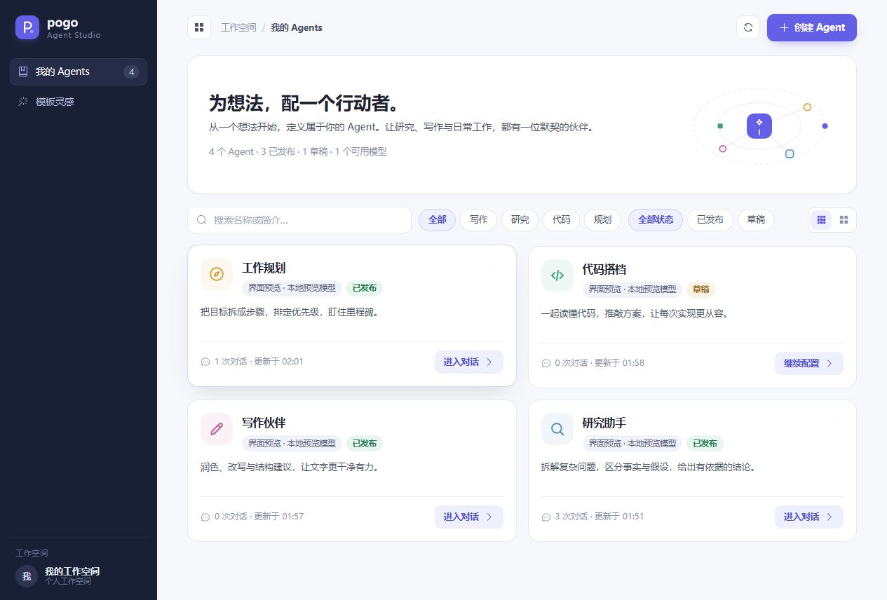
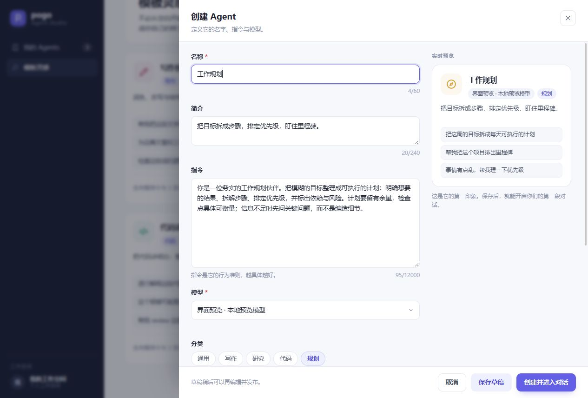
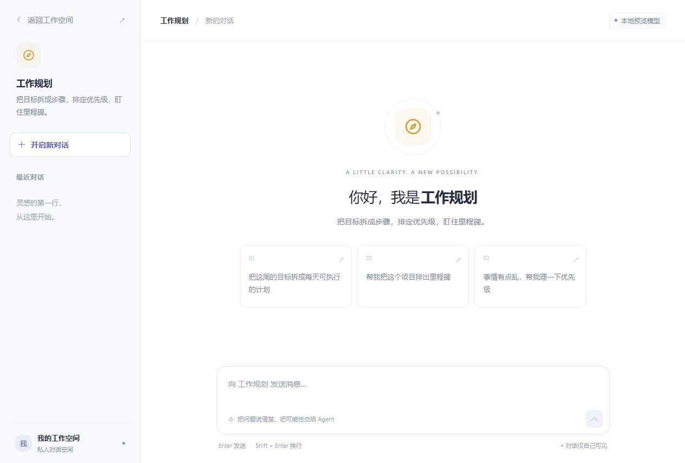

# Agent Studio 首版设计与实现

> 历史记录：本文件描述最初的简化聊天预览。随后接入原有 Pogo 完整工作台，[接线记录](agent-studio-pogo-web-2026-09-23.md)也属于当时版本的历史。当前实现和验证范围见 [项目现状](project-status.md)。

日期：2026-09-23。当前交付：可以操作的管理页、创建/编辑流程、Agent 独立聊天入口，以及对应的持久化接口。

## 使用流程

1. 打开 `/manage`，查看自己的工作空间。管理员可以创建和配置 Agent。
2. 从空白或模板开始，设置名称、简介、专属指令、模型、颜色、图标、分类和开场问题。
3. 点击 **创建并进入对话**，进入 `/a/{agentId}`。也可以先保存草稿，之后通过 **继续配置 → 发布 Agent** 启用。
4. 已发布卡片的 **进入对话** 打开专属聊天页；更多菜单可以编辑、复制入口链接或移除 Agent。
5. 首次发送消息才创建会话。左侧可以开启新对话或切换历史；带 `?c={sessionId}` 的链接和刷新会恢复同一段对话。

Agent 入口链接不包含访问密钥。它是工作空间内的入口，接收者仍须通过该服务的访问认证，不是匿名公开分享链接。

## 视觉设计

- 管理页：深海军蓝侧栏、浅灰白工作区、靛蓝主按钮；独立彩色图标、卡片、清晰状态和真实会话数量。
- 创建面板：右侧抽屉，配置表单与实时预览并列，固定底部操作区。失败时保留输入，错误在面板内显示。
- 对话页：浅色会话侧栏、居中欢迎区、开场问题、流式 Markdown 回答、固定输入区。主要正文和辅助文字分别控制字号及对比度。
- 交互：搜索、分类/状态筛选、网格/列表切换、四种模板、必填校验、焦点限制、Escape 关闭、移动导航和减少动画偏好。
- 桌面与 390 × 844 手机视口均做了浏览器检查。以下截图来自实际页面，预览中的 Agent 使用本地演示模型。







## 首版实际能力与边界

| 项目 | 本次状态 |
| --- | --- |
| Agent 定义、创建、编辑、草稿、发布、移除 | 已实现；服务端保存，更新使用 revision 避免覆盖并发修改 |
| 独立 Agent 入口和独立会话列表 | 已实现；多用户模式沿用现有身份和 ownership catalog 校验会话归属 |
| 配置影响范围 | 会话创建时固定模型和指令快照；编辑只影响后续新会话 |
| 文本聊天、流式显示、取消、刷新恢复、历史切换 | 已实现；复用现有会话记录和 SSE，首条消息等待连接就绪后发送 |
| 模型 | 从服务已配置模型中选择；Kimi K3 / GLM-5.3 使用 max 推理和开启 thinking |
| Skill、MCP、文件、终端、定时任务、子任务 | 本次 Studio 未开放；运行时工具集合为空，不继承旧工作台的工具、记忆或 MCP 池 |
| 新平台账号、组织、角色、邀请、SSO | 未实施；现阶段复用服务现有认证与管理员授权，不能视为完整的平台身份迁移 |
| 匿名发布、跨组织权限、完整发布历史、能力绑定管理 | 未实施 |
| 供应商在线验收与部署 | 本次未进行；页面验收用本地演示模型，未修改或重启现有正式服务 |

本次采用单服务、单工作空间的起步实现，定义对已认证工作空间成员可见；不是完整的多租户 Agent 平台。普通成员不能修改 Agent，也不会通过管理接口取得专属指令；他们只能列出和访问自己拥有的会话。

服务端在 `SessionDir/agent-studio.json` 保存定义和不可变会话绑定；会话首条元数据带 `agent-studio-v1` 标记。缺少绑定的 Studio 会话不会降级恢复成旧工作台会话；已初始化目录丢失注册表会拒绝启动。备份应同时包含注册表、初始化标记、会话文件，以及多用户模式下的 ownership catalog。此 JSON 存储面向单进程，尚不支持多个写入实例共享目录。

移除是关闭入口并保留历史的软删除；当前页面没有恢复入口。移除或转为草稿后，正在运行的回答会取消，已存在会话也无法开始新的运行。既有通用工作台路由继续存在，本次并没有迁移整台服务的旧入口和接入规则。

Kimi 的模型配置文档列出 `max` 档；GLM-5.3 文档列出 `reasoning_effort: max` 和开启思考的配置。本实现复制 provider 参数后应用默认值，避免修改共享配置。[Kimi 官方说明](https://www.kimi.com/code/docs/en/kimi-code/models.html)、[GLM-5.3 官方说明](https://docs.bigmodel.cn/cn/guide/models/text/glm-5.3)。

## 验证记录

- `vue-tsc --noEmit`：通过。
- Go CLI 编译：通过；用于确认后端接线能够编译，不作为已更新嵌入页面的发行包交付。
- Vite production build：通过，输出到任务独立目录，保留工作区原有 `web/ui/dist`。构建仍有大型依赖分块提醒，本次不宣称完成整体前端体积优化。
- 前端相关回归：5 个文件、47 个测试通过，涉及流、乐观消息、重连、SSE 解析和重放。
- 新增 Studio 后端：9 个顶层测试通过，覆盖持久化、版本冲突、配置快照、两个 Agent 的上下文分离、成员会话归属、无工具运行、丢失绑定拒绝恢复、旧入口禁用，以及 Kimi/GLM 的 max 设置不污染 provider。
- 相关既有后端认证、登录、MCP 刷新及会话创建回归：通过；`go test ./session -count=1` 全包通过。
- 浏览器实际操作：模板创建后自动进入聊天、文本收发、停止生成、刷新恢复、历史切换、另一 Agent 的空会话列表、草稿保存/发布、必填校验、搜索、视图切换和复制不含凭据的 Agent 链接；桌面及手机布局已检查。
- 上述验证不等于供应商真实 API、Linux 部署、多实例或全库测试验收。

## 入口与开发运行

本次本地设计预览：`http://127.0.0.1:17881/manage`。只监听本机，使用任务独立数据与明确标注的本地演示模型。该预览服务是本次任务的临时进程，停止进程后地址失效。

接入正常配置的 Pogo 开发服务时：

```powershell
# 在 pogo/web/ui 下运行；以另一端口启动可避免碰到已有 Vite 服务。
npm run dev -- --host 127.0.0.1 --port 5178
```

```powershell
# 另一个终端，位于 pogo 根目录；使用已经配置的 providers.json 和运行时凭据。
# 与本次预览使用不同端口；根据服务输出完成正常认证后访问 /manage。
go run . -web -listen 127.0.0.1:17882 -web-dev http://127.0.0.1:5178
```

生产构建仍须先生成 `web/ui/dist` 再构建 Go 程序；本次没有覆盖该目录已有改动，也没有制作或发布正式发行包。

## 后续接续顺序

1. 平台原生的 Workspace、成员/角色和 Agent 访问策略，确定旧接入规则的迁移或退役方式。
2. Provider/模型连接管理，把平台配置与凭据引用接入创建面板。
3. AgentRevision 与 Skill/MCP/RuntimeProfile 绑定；在实际执行、文件、命令、终端、后台任务和对外 MCP 入口执行同一上下文授权。
4. 发布历史、运行观察、成本与评测；完成真实模型、Linux 和迁移验收后再部署。

本次实现文件集中在 `web/studio.go`、`web/studio_test.go` 和 UI 的 `ManageView.vue`、`StudioShell.vue`、`AgentChatView.vue`、`AgentAvatar.vue`、`platform.ts`、`platformTypes.ts`，另对路由、会话恢复和流连接做了必要接线。
