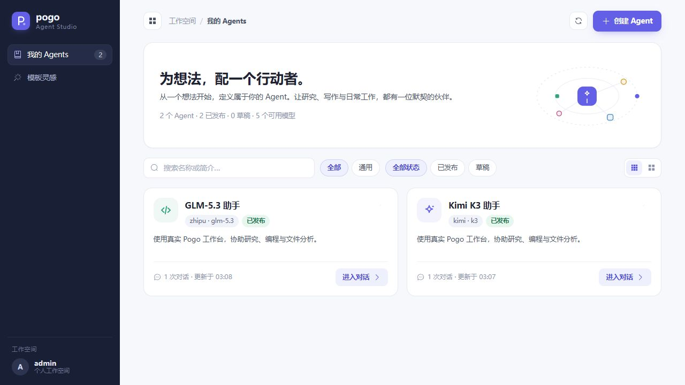
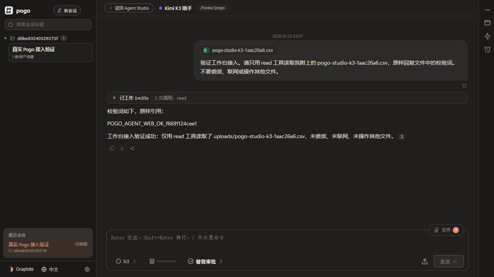

# Agent Studio 接入原有 Pogo Web

> 历史接线与验收记录（2026-09-23）；不是当前工作区的全量验收。后续能力及限制见 [项目现状](project-status.md)。

本次修正的是首版实现的方向：`/manage` 保留 Agent 管理界面，`/a/{agentId}` 使用原有 `AgentView.vue` 完整工作台。模型和工具通过真实 Pogo 后端执行，不再使用单独设计的简化聊天页面或演示回复。

## 实际连接方式

```text
/manage 创建、配置 Agent
    → /a/{agentId}
    → 原有 AgentView.vue
    → /api/apps/{agentId}/sessions
    → 固定 Agent 定义与会话的绑定
    → 原有 Manager.newSession / Agent 执行循环
    → 已配置的模型、工具、文件、审批、MCP 和原有工作台组件
```

新增会话记录使用 `agent-studio-web-v1` 标记，模型和 Agent 指令取自创建会话时保存的版本。读取、流式消息、文件上传、工作过程、取消、会话管理和文件面板复用已有 Web 接口。缺失绑定、运行类型不匹配或恢复时身份不匹配会拒绝恢复，不会静默改成通用 Agent。

原有 `agent-studio-v1` 文本实验会话继续保持原限制，避免升级时自动扩大已有会话能力；需要完整工作台时应新建会话。

## 保留的边界

- 新 Agent 使用现有 Pogo 账号认证与审批，不自动创建账号，不更换现有凭据。
- Agent 的对话列表和浏览器记忆分别保存。入口深链接、历史恢复和搜索按当前 Agent 筛选，不打开其他 Agent 的会话。
- Kimi K3 / GLM-5.3 的新 Agent 会话默认 `max` 并启用思考；已有会话不允许通过模型选择器绕过固定配置。
- 文件、技能、MCP、记忆、终端等继续采用现有 Pogo 账号和工作目录的权限。同一账号选择同一个工作目录的不同 Agent 可以共享文件；本次没有新增 Agent 之间的文件或能力权限边界。
- 这一轮不迁移组织/角色体系、独立 Skill/MCP 绑定、定时任务的 Agent 上下文和对外 MCP 的 Agent 授权。这些仍需后续平台化改造。

## 验收记录

在独立 Docker 测试实例完成了真实供应商调用：Kimi K3 和 GLM-5.3 均通过 Pogo 的 `read` 工具读取 CSV 测试附件，返回了附件里的随机校验词。检查包含实际工具调用、回复内容和模型使用量，而不只检查接口返回成功。

测试保持现有附件类型策略；测试文件使用允许的 CSV，且文件名各自唯一，避免同一用户工作目录里的并发测试相互覆盖。

17 个 Studio 后端顶层测试通过，涵盖标准运行时复用、真实本地只读工具、工作目录、身份、固定模型、绑定恢复、普通 Web 端点及旧文本会话兼容。

最终前端类型检查通过，58 个文件中的 3180 个前端测试通过。Linux Docker 环境下 `go test ./web ./session -count=1 -timeout 180s` 全部通过。Windows 的可选完整 Web 测试出现了路径/符号链接权限等失败和超时，对应场景已在 Linux 复核通过；修复了新增测试对宿主机 GLM 凭据环境的依赖，测试现在显式使用占位值和模拟客户端。

浏览器完成了创建 Agent、直接进入原版工作台、发送真实 K3 请求、遵循自定义指令、刷新恢复会话和返回管理页。正式服务还验证了从 Kimi 切换到 GLM 时只显示当前 Agent 的会话，两个页面分别使用管理页和原版工作台的样式。

## Docker 部署结果

2026-09-23 已更新现有 `pogo-base` 容器，继续使用 `127.0.0.1:19777 → 7777` 和原有 `pogo_pogo-home` 数据卷。

- 镜像：`pogo:agent-studio-web-20260923`
- 镜像 ID：`sha256:8a36771ed08cb5ab4bfc3e80e2d05c0af0f5585131f13f710806427eb1d459e2`
- 旧镜像保留为：`pogo:rollback-before-studio-web-20260923`
- 停机快照卷：`pogo_studio_backup_20260923_030521`，约 12 MB。
- 更新前确认没有运行中的会话；更新后原有 8 个会话 ID 全部保留。
- `users.json`、`deploy.env`、`providers.json`、`identity.json` 的 SHA-256 均与操作前一致。
- `pogo-yw-delegated`（19778）的容器 ID、启动时间和运行状态保持一致。

正式容器内再次完成真实供应商验收，每个模型都通过 Pogo `read` 读取独立 CSV 附件并返回随机校验词；两次运行均成功，有真实工具记录和非零模型使用量。

| 入口 | 地址 | 验收结果 |
| --- | --- | --- |
| Agent 管理 | http://127.0.0.1:19777/manage | 创建、配置、进入对话 |
| Kimi K3 助手 | http://127.0.0.1:19777/a/ag_3081e547a07f2231d4b47e6964723263 | `read` 1 次，校验词一致 |
| GLM-5.3 助手 | http://127.0.0.1:19777/a/ag_0c2b7d59565190564f079bc1cb71f071 | `read` 1 次，校验词一致 |

这两个 Agent 属于现有 admin 工作空间，使用原有登录方式进入。管理页创建的新 Agent 同样直接进入完整 Pogo 工作台。截图来自实际的 19777 容器页面：





## 运维与回滚

在 `pogo` 目录运行下面的命令可按当前配置启动已构建镜像，不需要重新构建：

```powershell
docker compose -f compose.yml up -d --no-build --no-deps pogo
```

需要回滚运行镜像时，先确认没有运行中的任务，再执行：

```powershell
docker compose -f compose.yml -f C:/Users/14777/.codex/agent-worker/maintenance/pogo-web-integration-20260923/rollback.compose.yml up -d --no-build --no-deps pogo
```

镜像回滚继续使用当前数据卷，原有普通 Pogo 会话保持可用；旧版本不提供新增的 Agent Studio 页面。快照卷单独保留，未自动覆盖当前数据。若需恢复快照，应先保存升级后的数据，再将快照复制到新卷并调整挂载，避免覆盖新产生的对话。

本次 Kimi K3 `max` Worker 完成原版页面适配，GLM-5.3 `max` Worker 完成后端测试；主 Agent 复核并补齐运行时绑定、主题与页面生命周期处理，执行 Linux 验证、真实供应商验收和 Docker 更新。证据保存在本机 `C:/Users/14777/.codex/agent-worker/maintenance/pogo-web-integration-20260923/`，包含测试日志、供应商调用验收、会话保留清单和受保护文件的哈希核验。
