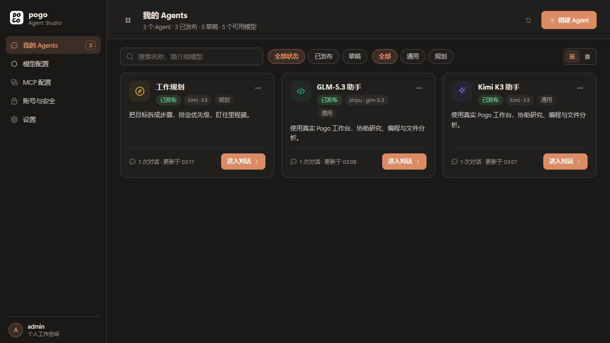
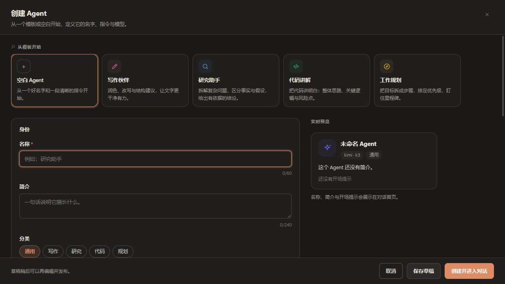
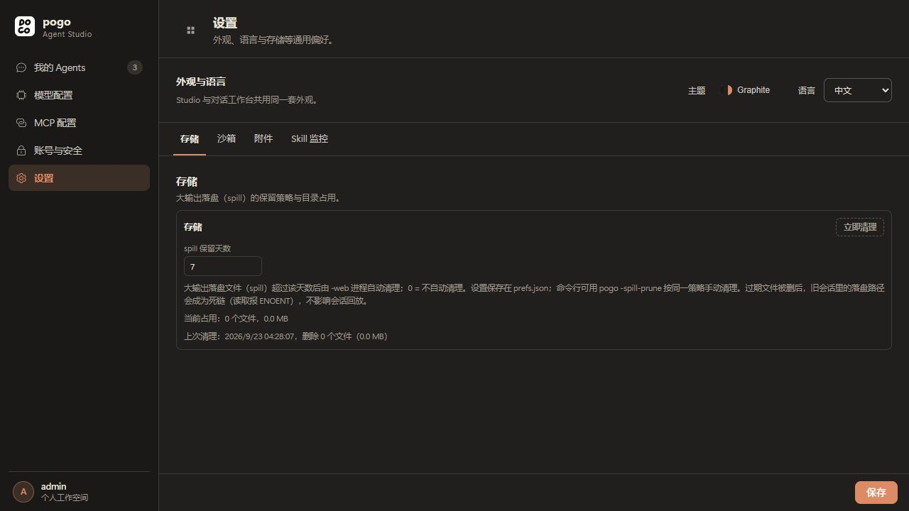
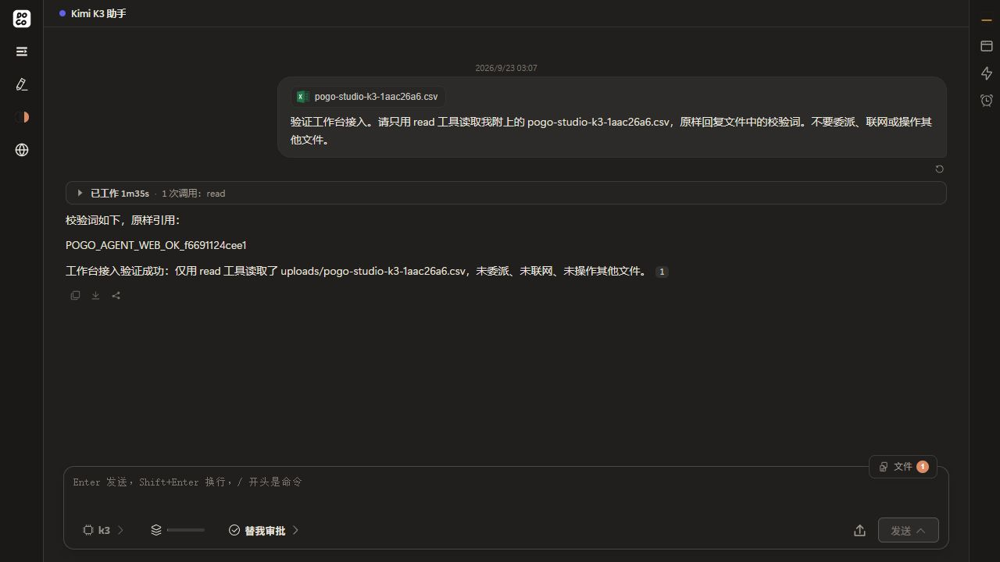

# Pogo Studio 界面与发布体验改造

> 本文保留 2026-09-23 的改造记录。当前能力、部署和验证范围见 [项目现状](project-status.md)，不要将本文的“本次”外推为后续所有版本。

本页记录首次界面改造及当时的部署验收。后续的 Skill 管理、MCP 管理命名和每个 Agent 的模型/能力勾选，见 [Agent 能力选择说明](agent-studio-capabilities-2026-09-23.md)。

目标是让 Studio 成为 Pogo 原生工作空间：管理模型、MCP、账号和 Agent；用户通过发布链接进入原有 Pogo 对话界面。

## 调研依据与设计取舍

本轮查阅官方产品文档与设计规范（2026-09-23），将事实与本项目的设计决定区分如下。

| 来源 | 已核对的做法 | 本次采用方式 |
| --- | --- | --- |
| [Dify 模型供应商](https://docs.dify.ai/zh/cloud/use-dify/workspace/model-providers) | 模型在工作空间共享，由工作空间管理员配置供应商 | 模型配置作为工作空间一级模块；单个 Agent 只选择模型 |
| [Dify 发布应用](https://docs.dify.ai/zh/cloud/use-dify/publish/README) | 发布提供 Web 应用、API、网站嵌入等渠道，并要求明确访问控制 | 区分管理内调试、发布链接和 iframe；发布页只保留对话体验 |
| [Botpress Webchat](https://www.botpress.com/docs/webchat/get-started/quick-start/) | 在 Dashboard 获取已发布 Bot 的嵌入代码，再加入业务网站 | 将发布链接、打开页面、复制 iframe 集中到 Agent 的发布面板 |
| [Carbon Create flows](https://v10.carbondesignsystem.com/community/patterns/create-flows/) | 简单模态框适合少量字段，复杂创建需要更大的表单空间 | 按用户要求使用全屏弹框，固定标题和操作区，表单与预览合理分栏 |
| [WAI-ARIA Dialog pattern](https://www.w3.org/WAI/ARIA/apg/patterns/dialog-modal/) | 模态窗口管理焦点、关闭操作及返回触发元素 | 创建弹框提供键盘导航、明确标签和未保存内容保护 |

这些来源用于核对产品结构和交互规范，视觉样式以本仓库现有 Pogo 为准。沿用 `theme/themes.ts`、主题变量、Logo、Element Plus 图标和既有控件；不再为 Studio 定义独立的紫色/浅色调色板。

## 信息结构

| 一级模块 | 内容 | 地址 |
| --- | --- | --- |
| 我的 Agents | 搜索、筛选、创建、编辑、调试、发布与嵌入 | `/manage` |
| 模型配置 | 供应商、模型、配置 JSON | `/manage/models` |
| MCP 配置 | 客户端服务器、服务发布、调用监控 | `/manage/mcp` |
| 账号与安全 | 原有账号、安全和登录相关设置 | `/manage/account` |
| 设置 | 外观与语言、存储、沙箱、附件、技能观测等 | `/manage/settings` |

模板仅出现在全屏创建界面内，不占据独立导航位置。设置模块复用原有配置表单和后端接口，不建立另一套配置来源。

## 对话入口

| 场景 | 路径 | 显示策略 |
| --- | --- | --- |
| 管理内调试 | `/manage/agents/{agentId}/chat` | 原版 Pogo 对话，保留返回 Studio |
| 发布链接 | `/a/{agentId}` | 原版 Pogo 对话，没有返回 Studio 和管理设置按钮 |
| iframe | `/a/{agentId}?embed=1` | 同一原版对话页面，紧凑默认布局，不展示管理入口 |

会话切换和刷新保留当前入口类型与 iframe 参数。链接和嵌入代码仅包含页面地址与 Agent ID，不带管理密钥、用户信息或历史会话 ID。发布与 iframe 继续遵守现有身份认证及会话所有权，不自动成为匿名访问或跨系统单点登录。

`/embed/` 是既有业务委托协议入口，本次普通 iframe 使用 `/a/{agentId}?embed=1`，不会混用两种身份协议。

## 验收清单

- Pogo Paper / Graphite 主题一致，无横向溢出；管理页、全屏创建和设置在桌面与窄屏可用。
- 创建时可选择模板或从空白开始；真实保存与进入对话正常，草稿状态不会显示为已发布。
- 五个模块可直接打开和刷新；原模型、MCP、账号与通用设置表单保持可用。
- 管理入口可以返回 Studio，发布与 iframe 页面没有管理设置或返回 Studio 按钮，包括加载失败状态。
- 跨来源 iframe 加载实际 Pogo 服务，可以登录、恢复会话与发送消息；原有认证和授权不被绕过。
- 前端类型检查、相关路由/设置测试、构建通过；实际浏览器和正式部署验收结果如下。

## 实际验收结果

2026-09-23 完成以下验证。配置写入与真实新对话在独立验收实例进行；正式服务验收只读取既有 Agent 与会话，没有修改现有 Agent 定义。

| 层级 | 结果与边界 |
| --- | --- |
| 静态与自动测试 | `vue-tsc --noEmit` 通过；Vitest **62 个文件、3215 个测试全部通过**，包含路由、发布入口、嵌入参数、设置分区和导航保护 |
| 构建 | 最终 Docker 镜像完成前端类型检查、Vite 生产构建与 Linux Go 编译；本轮没有改动 Go 后端，不将构建等同于新一轮 Go 全量测试 |
| 视觉 | 检查 Graphite 与 Paper 两套 Pogo 原生主题；桌面 1280×720 与窄屏 390×844。窄屏创建弹框实际边界为 390×844，无横向溢出，底部操作文字完整 |
| 管理模块 | 五个一级模块的直接路由和真实设置表单可用；外观、语言归入设置，模板只在创建弹框；空白创建、模板填充、保存后进入真实对话通过 |
| 未保存保护 | 改动设置后离开会提示；继续编辑保留改动，放弃改动可导航，重新进入后服务器值未被错误保存；创建弹框关闭同样提供未保存提示 |
| 发布与 iframe | 发布面板复制链接与 iframe 成功。跨来源父页面 `17882` 嵌入实际 Pogo 前端 `5179`（连接独立后端 `19779`），登录后 Kimi K3 真实回复 `STUDIO_UX_READY，可以开始对话。`，该次响应约 3.4 秒；刷新父页面后恢复会话。该耗时只记录本次验收，不代表性能基准 |
| 最终镜像与正式页面 | 最终镜像在 `19779` 再验收后部署到 `19777`；正式管理入口存在返回 Studio，`/a/{id}` 与 `?embed=1` 的返回按钮及设置按钮均为 0，既有真实工具调用与回答可回放 |

## 正式部署与回滚

- 服务：`pogo-base`，保持 `127.0.0.1:19777 → 7777`。
- 管理地址：<http://127.0.0.1:19777/manage>。
- 新镜像：`pogo:studio-ux-20260923`，镜像 manifest 为 `sha256:b5d0ac7c7fa5ef2a3fb725a313577ce04f099970b1e1fcadbbcc80357ea01e1e`。
- 原镜像保留为 `pogo:rollback-before-studio-ux-20260923`。
- 切换前的数据卷快照：`pogo_studio_ux_backup_20260923_042759`。正式数据继续使用原卷 `pogo_pogo-home`。
- 3 个 Agent 全部保留；10 条有内容会话的转录文件与快照 SHA-256 完全一致。一条只有元数据、没有任何消息的旧空会话由 Pogo 原有启动清理逻辑移除，快照中仍保留该记录。
- 账号文件、部署环境文件、供应商配置和身份配置哈希保持不变；`19778` 的 `pogo-yw-delegated` 容器未重启、未改动。
- 验收后已关闭本轮独立容器、Vite 与 iframe 测试服务，释放 `19779`、`5179`、`17882`；保留验收数据卷与正式部署前快照。

完整构建、测试、部署和数据校验日志位于本机 `C:/Users/14777/.codex/agent-worker/maintenance/pogo-studio-ux-20260923/`。恢复旧镜像时在 `pogo` 目录运行：

```powershell
docker compose -f compose.yml -f C:/Users/14777/.codex/agent-worker/maintenance/pogo-studio-ux-20260923/rollback.compose.yml up -d --no-build --no-deps pogo
```

普通 iframe 沿用 Pogo 现有登录与权限；本轮没有增加匿名访问、自动建号或跨系统 SSO。复制地址以当前访问域名为准，业务系统应使用浏览器能访问到的 Pogo 地址。

## 正式页面截图

### 我的 Agents



### 全屏创建



### 统一设置



### 发布后的真实 Pogo 对话


