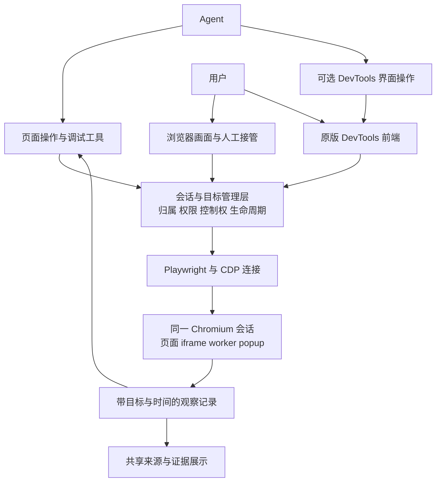

# Pogo 内置浏览器与 DevTools 调研报告

调研日期：2026-10-06。代码基线：`74bda3b` 及当前工作区。状态：研究与架构建议，尚未实施。

后续进展：用户已明确优先通用 browser-use 协议能力，不要求 agent 模拟人点击 DevTools。当前已实现的页面 CDP、网络/日志观察、调试恢复和兼容处理见[实现与验证记录](browser-devtools.md)。本报告以下内容保留调研时的事实与完整目标，不能视为全部已交付。

依据：本轮查阅的厂商官方文档、开源项目官方源码，以及 Pogo 当前源码。产品公开能力、API 能力、工程推论分别表述；没有进行竞品成功率排名，也没有把厂商未公开的内部实现当作事实。本轮没有运行浏览器验收或修改产品代码。

**一、直接回答三个问题**

**1. 有现成的“带开发者工具的内置浏览器”吗？有。** Electron、CEF、WebView2 都有成熟的 DevTools 入口；Chrome 的原版 DevTools 前端也能独立部署，远程连接 Chromium。对当前 Pogo Web 产品，优先研究复用现有 Chromium、接入原版 DevTools 前端，无需先迁移为桌面应用。具体能力与官方依据见下文选型表。

**2. 通用路线可行吗？可行，而且有领先产品的公开实践支持。** 建议目标是：用户拥有标准 DevTools，agent 能通过标准调试协议使用同一个浏览器会话；同时保留截图、鼠标、键盘和页面结构操作。需要时，agent 也能把 DevTools 当作独立界面操作。单会话原型难度中等，可靠的多用户产品难度较高。

**3. 之前的实现怎么处理？保留浏览器和控制底座，把定制能力改为可选适配器，逐步退役旧执行路径。** Pogo 已使用真实 Playwright/Chromium；问题在于给 agent 的观察和调试入口还不够完整。当前并不是仅修改 `browser-use/SKILL.md` 就能完成的工作，涉及运行时、会话与权限、Web 面板、工具接口和评测。

建议的建设目标是：**标准浏览器内核 + 原版 DevTools + 同会话的 agent 调试接口 + 可核查的证据与人工接管。**

**二、ChatGPT、Claude 等公开方案实际做到了什么**

| 对照对象 | 官方已确认的能力 | 不能由此推导的结论 | 对 Pogo 的启发 |
| --- | --- | --- | --- |
| ChatGPT 桌面 Browser 开发者模式 | 内置浏览器及 Chrome 支持受控的 full CDP；可检查 Console、Network、DOM/CSS、分析 JS 性能。[官方文档](https://learn.chatgpt.com/docs/browser#developer-mode) | 不能证明所有 ChatGPT 云端浏览器都开放同样能力，也不能证明其默认靠点击 DevTools UI 工作 | 普通浏览和深度调试可以共存；标准协议可以成为通用能力入口 |
| Claude Desktop 内置浏览器 | 官方说明侧栏内置浏览器独立于个人浏览器，具备 Claude in Chrome 的浏览能力；使用时桌面应用需在线。[官方文档](https://support.claude.com/en/articles/16607400-use-the-built-in-browser-in-claude-cowork) | 该说明没有承诺完整 DevTools UI、断点单步或全量 CDP | “内置浏览器”已有产品实例，但还需单独核对调试能力 |
| Claude in Chrome / Claude Code with Chrome | 页面阅读和操作，以及 Console 错误、网络请求、DOM 检查；Claude Code 可利用现有 Chrome 登录会话。[扩展说明](https://support.claude.com/en/articles/12012173-get-started-with-claude-in-chrome)、[Code 集成](https://code.claude.com/docs/en/chrome) | 未公开完整 Sources、Memory、Performance 的覆盖，更未证明每一步通过面板点击 | 浏览器自动化与诊断信息互补，登录态应属于同一个真实浏览器会话 |
| Anthropic Browser Use API | 页面结构与视觉结合；可选 `read_console`、`read_network`、`javascript_exec`，由接入方执行。[官方工具文档](https://platform.claude.com/docs/en/agents-and-tools/tool-use/browser-use-tool) | API 工具集不代表 Claude 产品内部架构；网络摘要不等于完整 Network 面板 | 基础动作、观察和高权限执行分层；工具按实际能力启用 |
| Anthropic Computer Use API | 截图与鼠标键盘等桌面动作，由接入方提供执行环境。[官方文档](https://platform.claude.com/docs/en/agents-and-tools/tool-use/computer-use-tool) | 不能把 Computer Use 本身当作 DOM、Network 或完整调试接口 | 视觉控制适合界面兜底，协议诊断另行接入 |
| Google Chrome DevTools MCP | 可连接现有 Chrome，提供网络、Console、JS、CSS、性能、内存等工具。[连接说明](https://github.com/ChromeDevTools/chrome-devtools-mcp/blob/main/docs/advanced-usage.md)、[工具表](https://github.com/ChromeDevTools/chrome-devtools-mcp/blob/main/docs/tool-reference.md) | MCP 本身不是给用户的 DevTools 界面；当前工具表不等于全量 CDP 或完整断点单步集合 | 可复用为 agent 的诊断适配层，仍需 Pogo 会话与权限集成 |
| Microsoft Playwright MCP | 结构化页面操作、快照、网络和 Console 等工具，支持已有 CDP/Playwright endpoint。[官方仓库](https://github.com/microsoft/playwright-mcp) | 不提供与 Chrome 原生 DevTools 等价的全套用户界面 | 参考标准化工具组织；已有 worker 不必为了 MCP 重写 |
| browser-use / cdp-use | 通用页面动作、JS 执行、CDP 连接；底层库覆盖多个调试域。[工具](https://docs.browser-use.com/open-source/customize/tools/available)、[配置](https://docs.browser-use.com/open-source/customize/browser/all-parameters)、[协议库](https://github.com/browser-use/cdp-use) | 底层库支持某个域，不代表默认 agent 已具备该域全部工具 | 通用性来自浏览器与协议覆盖，可选高层工具负责效率 |

这些公开材料支持“页面操作 + 结构化观察 + 按需深入调试”的路线。没有充分公开证据证明领先产品普遍要求 agent 像人一样逐个点击 DevTools 标签页。这里的 SOTA 对标是能力与架构参考，不是同一测试条件下的效果排名。

OpenAI 的开发者模式还明确区分普通网站访问与 full CDP 访问，允许组织限制后者。这说明深度调试应成为可明确启用的能力，而不宜在普通浏览中悄悄扩大访问范围。[开发者设置](https://learn.chatgpt.com/docs/developer-settings)

**三、先把“完整 DevTools”定义清楚**

需要分别验收三件事：用户看得到真实面板；agent 调得到对应能力；两者操作的确实是同一个页面、登录态和请求。

| 层次 | 应覆盖的内容 | 对 Pogo 的意义 |
| --- | --- | --- |
| 核心调试 | Elements、CSS、Console、Network、Sources、断点/调用栈/单步、source map | 应作为正式目标，不能只增加两个日志列表就宣称完整 |
| 深度诊断 | Application/Storage、Service Worker、Performance trace、Memory/heap、设备模拟、下载导出 | 分项验证数据可取、target 正确、体积可控和生命周期可靠 |
| 桌面宿主能力 | 本地目录工作区、DevTools 扩展、原生窗口停靠、系统文件交互、宿主 AI 集成 | 独立网页前端不能自动获得，需要宿主桥接或桌面架构 |

Chrome 官方支持 DevTools 前端独立构建和 hosted mode：网页加载前端，再连接被检查页面的调试 WebSocket。[官方构建文档](https://github.com/ChromeDevTools/devtools-frontend/blob/main/docs/get_the_code.md)

但官方 hosted 宿主 stub 对扩展、本地工作区连接、目录索引和部分窗口功能存在未实现或不支持项。因此，对第一阶段应准确命名为“原版 DevTools 核心调试面板”；完成额外宿主适配前，不承诺与桌面 Chrome 的所有功能百分之百等价。[官方宿主实现](https://raw.githubusercontent.com/ChromeDevTools/devtools-frontend/main/front_end/core/host/InspectorFrontendHostStub.ts)

**agent 如何使用它：建议提供两个互补入口。**

| 入口 | 适用工作 | 成本与边界 |
| --- | --- | --- |
| 标准协议/结构化调试 | 查请求及响应、Console、DOM/CSS、调用栈、性能；按目标和 ID 精确取证 | 通常更容易过滤、复核和控制输出量；需协议版本、权限和目标管理 |
| DevTools 可视界面 | 用户交接核查、操作尚未封装的面板、验证视觉结果 | 要为 DevTools 单独提供画面、焦点、输入和目标绑定；只向业务页面发送 F12 不够 |

通用路线可以保留少量常用工具，再提供按需发现和编排的 CDP 能力，避免为每个网站写接口，也避免把所有协议方法堆成一个巨大工具列表。程序化调用应在受控执行器中运行，不能因此获得 worker 的任意文件、网络或环境变量权限。这是推荐设计，尚未在 Pogo 实现。

如果用户要求 agent 必须能“自己打开 Network、点请求、读 Response”，也可以作为独立验收项。此时 DevTools 必须是可操作的第二个界面；仅把前端嵌在用户浏览器里，并不会自动让服务器端 agent 看见它。

一种可验证的实现是：服务器用专门的页面 B 渲染 DevTools，连接业务页面 A；把 B 注册为 DevTools surface，提供独立的截图、焦点和输入，让 agent 实际点击 Network、请求行和 Response。用户若要看到 agent 当前选中的请求与操作过程，应观看同一个 B surface；分别打开两个 DevTools 前端，不会自动同步面板选中状态。这是工程方案，仍需原型验证。

**四、现成技术选型**

| 方案 | 能否提供真实 DevTools | 对现有 Pogo 的改造量 | 建议 |
| --- | --- | --- | --- |
| 保留 Playwright/Chromium，托管原版 DevTools frontend | 能提供原版核心面板，宿主功能需补足 | 中到高：前端托管、调试通道、会话/target 管理、控制权协调 | **当前 Web 产品首选研究路线** |
| 完整 Chrome 窗口 + 远程桌面/浏览器界面流 | 可保留 Chrome 自身界面及 DevTools，具体部署仍需验证 | 高：新增整窗画面与输入、焦点、桌面生命周期及资源管理 | 对原生 UI 一致性要求非常高时比较；当前 page 截图通道不能直接替代 |
| Electron BrowserWindow / WebContentsView | 有 `openDevTools()`，可指定承载 DevTools 的 WebContents | 高：转为桌面宿主，增加打包、更新与多平台生命周期 | 同时决定做桌面产品时再选。[官方 API](https://www.electronjs.org/docs/latest/api/web-contents#contentsopendevtoolsoptions) |
| CEF / WebView2 原生嵌入 | 有 DevTools 和协议调用接口 | 高：原生宿主工程及平台适配 | 已有对应原生架构时适合。[CEF](https://github.com/chromiumembedded/cef/blob/master/include/cef_browser.h)、[WebView2](https://learn.microsoft.com/en-us/microsoft-edge/webview2/how-to/debug-devtools) |
| 只接 Chrome DevTools MCP | agent 能使用工具表中的诊断能力；本身不提供用户全套 UI | 中：会话连接与权限集成仍要做 | 可作为适配层，单独采用不能完成本次全部目标 |

两个容易影响选型的细节：

- 无头模式并不等于无法调试。Chrome 官方支持远程连接 headless Chrome 的 DevTools；但 Pogo 实际使用的浏览器发行物、启动方式和前端版本仍需一起验证。[官方 headless 调试](https://developer.chrome.com/docs/automation-and-testing/debug-headless)
- Electron 的 `webContents.debugger` 文档明确：对已附加的 WebContents 打开 DevTools 会使该调试会话断开。即使选 Electron，也要验证外部 CDP 或重连策略，不能直接承诺 UI 与该 API 无缝并行。[官方 Debugger 文档](https://www.electronjs.org/docs/latest/api/debugger)

Pogo 应继续保留已有 Playwright 连接。不要仅为接入 DevTools，就把全部自动化迁到 `connectOverCDP()`；Playwright 官方明确该连接的保真度低于 Playwright 协议连接。[连接说明](https://playwright.dev/docs/api/class-browsertype#browser-type-connect-over-cdp)

**五、Pogo 当前已具备和缺少的部分**

以下是本轮源码审计，不代表当前部署已完成相同验收。

| 模块 | 当前事实 | 转向后的处理 |
| --- | --- | --- |
| Chromium worker | 一个共享 Chromium，各会话创建独立非持久 BrowserContext。[server.js:40](/Users/wangy/Documents/DiscoverAgent/pogo/browser-runtime/src/server.js:40) | 保留运行时；完整 CDP 场景需重新选择进程与会话隔离方式 |
| 浏览器面板 | 展示服务器页面截图，转发鼠标键盘，支持人工接管；没有标准 DevTools 前端。[NativeBrowserPane.vue:177](/Users/wangy/Documents/DiscoverAgent/pogo/web/ui/src/components/NativeBrowserPane.vue:177) | 增加 DevTools 入口和独立界面状态；明确当前检查的 tab |
| 控制链 | 有串行队列、generation、人工 lease、op_id 去重、取消确认。[session.js:381](/Users/wangy/Documents/DiscoverAgent/pogo/browser-runtime/src/session.js:381)、[native_browser.go:179](/Users/wangy/Documents/DiscoverAgent/pogo/web/native_browser.go:179) | 保留，调试写操作也必须遵守同一控制权 |
| 任务授权与归属 | Go 层 BrowserGate 管理任务访问，UI API 校验会话 owner；worker 只认识服务级凭据。[browser.go:95](/Users/wangy/Documents/DiscoverAgent/pogo/web/browser.go:95)、[native_browser_api.go:50](/Users/wangy/Documents/DiscoverAgent/pogo/web/native_browser_api.go:50) | 新 CDP 入口必须接入这些约束 |
| 网络观察 | 当前事件只维护在途请求以判断页面稳定，不保存完整请求/响应历史。[session.js:130](/Users/wangy/Documents/DiscoverAgent/pogo/browser-runtime/src/session.js:130) | 新增真实网络事件记录与按 ID 读取能力 |
| 调试接口 | worker 路由无 CDP、Console、Debugger 或 DevTools 接口。[server.js:59](/Users/wangy/Documents/DiscoverAgent/pogo/browser-runtime/src/server.js:59) | 新增标准调试连接及 agent 适配层 |
| 登录状态 | context 隔离 Cookie/存储；关闭、回收、重启后没有持久 profile 恢复契约。[运行时文档](/Users/wangy/Documents/DiscoverAgent/pogo/docs/native-browser-runtime.md:65) | 持久登录单独设计归属、恢复和清理，不能因接入 DevTools 就默认获得 |

历史记录中曾有一次独立 Docker/模拟站点实验：使用完整 Chromium 的新 headless 模式，操作真正的 DevTools Network/Headers/Response，并确认业务请求只发生一次。**这只是此前的可行性记录，本轮未重跑；它没有集成到产品，也没有证明真实网站验收通过。** 当前源码仍然缺少上述调试入口。[历史实验记录](/Users/wangy/Documents/DiscoverAgent/.localagent/checks/browser-devtools-analysis-20261004/headed-full-headless-visual-review.json)

**六、推荐架构与真正的工程难点**

建议在现有运行时外围增加统一的会话和调试连接管理层。下面是目标架构，不是当前实现图。

这里“同一会话”要求同一个真实页面及 Cookie、存储、frame、请求和运行状态。另开一个浏览器导航到相同 URL，不能算同会话接入。

**难点 1：完整协议与多用户隔离。** CDP 的 browser-level 连接具有目标枚举、附加和浏览器范围操作能力。Pogo 当前一个进程里有多个 context；直接暴露浏览器 WebSocket 会绕开现有入口的归属检查。推荐先验证“按安全边界或授权会话独立浏览器进程”，评估内存和启动成本；如果继续共享进程，就要完整约束 context、target、CDP session、事件和全局方法。独立进程也不自动构成 OS 沙箱，部署隔离仍须保留。这是基于协议和当前架构的工程判断。[CDP 协议定义](https://raw.githubusercontent.com/ChromeDevTools/devtools-protocol/master/json/browser_protocol.json)

**难点 2：人和 agent 同时控制。** Chrome 支持多个调试客户端，但它们操作同一页面，各自持有独立的 CDP 连接/session，并非共享一个底层协议会话。用户修改 DOM、执行 JS、暂停断点或拦截请求，会影响 agent；DevTools 建连时也可能自动恢复断点、缓存设置等。第一版应在进入人工调试时先取得页面控制权，再放行调试连接，并暂停 agent 的有状态动作；后续再增加已验证的并行观察。Debugger 暂停必须成为显式状态，避免把页面暂停误判成超时后继续重试。[多客户端说明](https://developer.chrome.com/blog/new-in-devtools-63#multi-client)、[Debugger 协议](https://chromedevtools.github.io/devtools-protocol/tot/Debugger/)

**难点 3：多 tab、iframe、worker 和重连。** 需要维护 Pogo session → browser/context → target → CDP session 的映射，并处理导航、弹窗、跨进程 iframe、worker、关闭和崩溃。此前 DOM 层 iframe 测试不能证明这些调试目标已经正确绑定。[Target 协议](https://chromedevtools.github.io/devtools-protocol/tot/Target/)

**难点 4：读到的证据是否真实、完整。** Network 必须先采集，才能读取已发生的请求；正文可能未捕获、超限或失效。记录应带 session、tab、frame、navigation、request/redirect 身份和时间，并明确 unavailable/truncated 等状态。读取记录不应悄悄变成重新发请求；刷新、重放、JS fetch 应单独作为动作。大 trace、heap、响应体存为 artifact，agent 按需取片段。[Network 协议](https://chromedevtools.github.io/devtools-protocol/tot/Network/)

**难点 5：执行权限不能靠工具名称判断。** Console 求值、Runtime.evaluate、Storage 和 Network 可接触登录态及非 DOM 信息；表达式也可能发请求或改变状态。普通浏览、被动观察、脚本执行、调试暂停/修改、请求重放应有明确能力边界。原始 CDP 和前端自动发送的命令也要经过连接层约束，不能只管理某几个 UI 按钮。敏感字段处理应覆盖新的证据出口；已获授权的业务响应仍应可供 agent 分析。

**难点 6：浏览器版本和宿主兼容。** 固定 Playwright、Chromium 与 DevTools frontend 的兼容组合，按运行时发现能力。需要实际测试 WSS 代理、前端 CSP、快捷键、下载、会话销毁及大文件。CDP 是 Chromium 生态的通用调试协议，不是 Firefox/Safari 的统一接口；跨内核需求另行设计。

按当前基础评估：

| 工作阶段 | 相对难度 | 最大不确定性 |
| --- | --- | --- |
| 单会话连接原版前端，查看 Console/Network/DOM | 中 | 实际 Chromium 发行物、target 暴露和前端兼容 |
| agent 与用户分别连接同一 browser/page | 中高 | 独立协议连接的控制权、断点暂停、取消与重连 |
| 多用户长期运行、完整核心调试能力 | 高 | 会话隔离、多 target、日志与大产物生命周期 |
| 桌面 Chrome 宿主功能完全对齐 | 高，需持续维护 | 本地文件系统、扩展、原生窗口等宿主适配 |

在实际验证“前端连接、进程隔离、断点与现有队列协同”之前，不宜承诺固定工期。获取 DevTools UI 的原型成本，明显小于把它可靠集成进多用户 agent 产品的成本。

**七、已做的“伪通用”功能如何迁移**

不建议一概称作伪通用：其中有真正跨站可复用的浏览器与控制能力，也有覆盖范围有限的高层适配。应按责任拆分。

| 现有部分 | 建议处理 | 原因与代码依据 |
| --- | --- | --- |
| Playwright/Chromium、tab/frame、截图与输入 | 保留并扩展 | 通用浏览器底座已经存在 |
| 接管、队列、generation、op_id、取消确认、旧观察失效 | 保留为统一控制机制 | 新接口不能重新引入重复提交、旧命令复活和错误目标操作 |
| `snapshot/find` 文本与角色近似提取 | 保留为低成本阅读入口，增加标准 DOM/AX/CSS 下钻 | 当前提取不等于原生可访问性树或完整布局/样式信息。[session.js:557](/Users/wangy/Documents/DiscoverAgent/pogo/browser-runtime/src/session.js:557) |
| `evidence.js` 表格、段落、标题等结构化抽取 | 改为可选“页面结构提取”适配器 | 跨站有用，但只覆盖指定 HTML 结构且受 frame/条目上限限制。[evidence.js:23](/Users/wangy/Documents/DiscoverAgent/pogo/browser-runtime/src/evidence.js:23)、[session.js:529](/Users/wangy/Documents/DiscoverAgent/pogo/browser-runtime/src/session.js:529) |
| `quantities.js` 数值解析和计算 | 拆为可选计算辅助 | 单位白名单和 compare/sort/difference/sum 不是通用浏览器边界；保留可追溯计算价值。[quantities.js:43](/Users/wangy/Documents/DiscoverAgent/pogo/browser-runtime/src/quantities.js:43) |
| `auth_status/api_read` | 保留兼容，逐步降低默认依赖 | 目前是启发式寻找部分存储凭据后，由 Node 新发受限 GET；不是被动读取浏览器 Network，也不是完整浏览器认证流程。[auth.js:156](/Users/wangy/Documents/DiscoverAgent/pogo/browser-runtime/src/auth.js:156)、[auth.js:259](/Users/wangy/Documents/DiscoverAgent/pogo/browser-runtime/src/auth.js:259) |
| legacy iframe / `browserExec` / `browserDom` 执行链 | 新路径达标、确认无依赖后退役自动化用途 | 同源代理和页面配合协议限制了通用性；仍用于业务面板的桥接不能顺手删除。[browserDom.ts:1024](/Users/wangy/Documents/DiscoverAgent/pogo/web/ui/src/agent/browserDom.ts:1024)、[browser.go:183](/Users/wangy/Documents/DiscoverAgent/pogo/web/browser.go:183) |
| 引用与 Sources 展示 | 保留共享组件，接入新的浏览器证据身份 | 来源系统同时服务文件、命令、浏览器和 MCP，不能随 browser-use 转向整体删除。[source.go:94](/Users/wangy/Documents/DiscoverAgent/pogo/agent/source.go:94) |
| `browser-use/SKILL.md` | 随实际能力重写使用策略 | skill 负责何时观察/操作/下钻，不负责实现浏览器；工具能力由运行时实际提供。[当前 skill](/Users/wangy/Documents/DiscoverAgent/pogo/skills/builtin/browser-use/SKILL.md:123) |

网络相关的新主流程应当是：**在真实页面登录 → 观察页面实际发出的请求 → 按请求 ID 查看相关响应 → 必要时明确执行额外动作 → 用页面或服务结果验证。** 这样不要求预先知道网站 API 路径，也不把寻找或输出 token 当作完成任务的前提。

已有人工 API grant 接口当前返回 410，迁移不需要把那套旧配置复活。[当前实现](/Users/wangy/Documents/DiscoverAgent/pogo/web/native_browser_auth.go:57)

**八、建议实施顺序与验收标准**

| 阶段 | 交付物 | 必须通过的验收 |
| --- | --- | --- |
| 0. 固定边界与基线 | 能力矩阵、会话/profile 归属、进程隔离方案、现有行为基线 | 明确哪些功能当前存在、哪些是目标；不以历史模拟成绩代替新验收 |
| 1. 同会话 DevTools 原型 | 在独立标签页连接 Pogo 现有页面的原版前端，并验证 DevTools surface | 同一登录态；Console/Network/DOM 可用；agent 能实际点击请求和 Response；详情对应已发生请求；关闭不误伤其他会话 |
| 2. agent 调试接口 | 常用诊断工具及按需协议调用，接统一目标/权限层 | agent 找到失败请求与原因；可回指同一请求和 frame；日志缺失明确报告；不额外重放 |
| 3. 核心完整性 | Sources/断点、Storage、Performance、Memory、多 target | source map 断点暂停/继续；iframe/worker/popup 归属；大文件可导出；人工接管和重连不回退 |
| 4. 产品面板与可选视觉操作 | 浏览器旁 DevTools 面板；需要时可操作 DevTools surface | 用户与 agent 能定位同一请求/节点；焦点、截图版本、输入、接管各有明确归属 |
| 5. 迁移和退役 | 旧 action 兼容层、精简 skill、新评测与弃用清单 | 新路径覆盖原核心任务；旧自动化依赖清零后再删除 |

阶段 1 即应验证隔离，不应把它留到最后。逐步迁移时可比较两条路径的只读结果；点击、提交、删除、请求重放等有状态动作只由一条路径执行，避免“双跑验证”导致重复副作用。

建议使用以下真实任务验收通用性，而不只验证工具返回成功：

- 不预置 API 路径：网页登录后，从真实 Network 找到目标列表请求和响应，说明数据来源。
- 点击后页面报错：关联请求、响应与 Console 堆栈，区分前端异常、网络失败、权限问题。
- 带 source map 的页面：命中断点，读取调用栈，人工接管，再恢复 agent；不发生失控重试。
- 跨 origin iframe、popup、worker 任务：证据归属正确，不误用另一 tab 的请求或节点。
- 多会话并行：A 无法枚举或控制 B 的目标；退出/断线/销毁后旧连接不能继续操作。
- 页面只显示部分数据、正文过大或未采集：结果诚实反映观察范围，引用能回到当时证据。
- 未见网站与长任务：记录最终任务正确率、错误写入/重复提交、延迟、token、重试和人工介入；用页面或服务状态核查结果。

当前 general-web 文档说明其是受控合成站点评测；evidence 套件也只是特定接口与来源/计算验证。保留这些回归价值，但不能直接据此宣称真实互联网通用能力已经达标。[general-web 说明](/Users/wangy/Documents/DiscoverAgent/pogo/browser-runtime/eval/general-web/README.md:3)、[evidence 说明](/Users/wangy/Documents/DiscoverAgent/pogo/browser-runtime/eval/evidence/README.md:31)

**建议决策：继续强化现有内置浏览器，优先验证原版 DevTools 与标准 CDP 的同会话接入。** 保留页面视觉控制和已有控制底座；把结构抽取、计算与认证辅助改成可选层。以能力矩阵和真实任务决定何时可以称为“完整开发者工具”，再根据宿主功能需求决定是否引入桌面壳。
