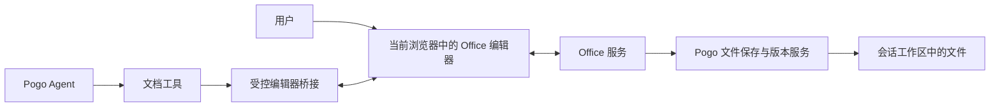

# Pogo Word 和 Excel 可视化编辑与 Agent 集成调研

调研日期：2026 年 10 月 12 日。

Pogo 应复用现成 Office 编辑器，自己实现文档会话、Agent 操作、审阅和保存。按当前 Docker Web 部署、同时支持 Word 与 Excel 的目标，建议先验证 ONLYOFFICE Community 加 Pogo 插件桥接；若以后以高度定制表格体验为主，再评估 Univer。两者的格式保真、操作延迟和 Agent 桥接效果都需要用目标文件验证，当前结论属于选型建议。

本报告只新增调研文档，不修改产品功能或部署服务。公开产品能力、官方接口和下面提出的 Pogo 集成设计分别陈述，官方声称支持某种格式不视为已通过 Pogo 验收。

## Pogo 当前能力与升级范围

内置 `docs` 提供 Word 的结构和正文读取、Excel 的工作表与行范围读取、PDF 文字层读取。Word 解析采用 OOXML，Excel 使用 openpyxl，公式只读取文件已有缓存值。[当前技能说明](/Users/wangy/Documents/DiscoverAgent/pogo/skills/builtin/docs/SKILL.md:20)

前端已有文件预览入口：Excel 使用异步加载的 `@vue-office/excel`，Word 展示后端转换的 Markdown；当前编辑按钮仅对完整读取的文本文件开放。现有网格预览和 Word 文本转换没有形成可写回原 Office 文件的编辑会话。[文件预览组件](/Users/wangy/Documents/DiscoverAgent/pogo/web/ui/src/components/FilePreview.vue:12)、[编辑条件](/Users/wangy/Documents/DiscoverAgent/pogo/web/ui/src/components/FilePreview.vue:212)

升级需要四个部分：Web Office 编辑器、文档会话和存储、Agent 结构化操作接口、技能说明。仅修改 `SKILL.md` 或增加 Python 写文件脚本，无法自动获得同屏编辑、撤销和保存同步。

## SOTA 产品采用的路线

| 产品 | 可确认的做法 | Pogo 可以借鉴的体验 |
| --- | --- | --- |
| ChatGPT 和 Codex | 桌面端预览生成文件，支持标注后请求定向修改；官方文档也列出 Excel 插件连接能力。 | 文件就在会话旁边，用户指向具体内容后继续修改。[文件工作流](https://learn.chatgpt.com/docs/artifacts-viewer)、[Excel 插件与 Computer Use](https://learn.chatgpt.com/docs/computer-use) |
| Claude for Microsoft 365 | 在真实 Word 和 Excel 内工作；Word 提供修订，Excel 高亮修改单元格，沿用模板和格式约定。 | 修改当前文档，明确显示改了哪里，保留审阅入口。[官方产品说明](https://claude.com/claude-for-microsoft-365) |
| Microsoft Copilot | 官方已发布 Word、Excel、PowerPoint 的多步原生编辑能力。 | Agent 完成任务后，编辑画布里直接出现结果。[官方发布](https://www.microsoft.com/en-us/copilot/blog/2026/04/22/copilots-agentic-capabilities-in-word-excel-and-powerpoint-are-generally-available/) |
| Gemini in Sheets | 可处理公式、格式、透视表和行列操作；动作有预览、应用和撤销入口，Excel 文件使用相关功能前需转换为原生 Google Sheets。 | 操作按工作表和范围定位，用户能查看拟修改内容与结果。[官方使用说明](https://support.google.com/docs/answer/14356410?hl=en) |

Claude 聊天中的文件生成另外使用隔离执行环境，运行代码并交付文件；它与 Office 插件操作已打开的文档是不同交付方式。[Claude 文件创建与编辑](https://support.claude.com/en/articles/12111783-create-and-edit-files-with-claude)

当前 Codex 环境中 Excel Live Control 的技能定义更明确：工作簿读写通过连接的文档工具完成，Computer Use 用于设置、目标确认和焦点管理。这能作为 Pogo 工具契约的参考，不代表 OpenAI 已公开完整产品内部架构。[当前技能定义](/Users/wangy/.codex/plugins/cache/openai-primary-runtime/spreadsheets/26.1011.11113/skills/excel-live-control/SKILL.md:9)

公开资料未披露 ChatGPT 文档预览底层使用哪家 Office 引擎，也不足以断言 Claude 或 Copilot 的内部实现全部使用 Office.js。可借鉴的是可观察的编辑与审阅流程。

## 可集成方案比较

| 方案 | 形态与覆盖 | 开源与商业边界 | 对 Pogo 的判断 |
| --- | --- | --- | --- |
| ONLYOFFICE Docs | 完整在线套件，统一文档、表格、演示；有 Docker 和 ARM64 安装文档。 | Community 为 AGPLv3 加附加条款；外部 Automation API 仅 Developer 且额外付费。 | 优先验证统一 Word 和 Excel 路线；Community 自制插件桥可作为原型入口。[安装](https://helpcenter.onlyoffice.com/docs/installation/docs-community-install-docker-arm64.aspx)、[许可更新](https://www.onlyoffice.com/blog/2026/05/onlyoffice-docs-9-4)、[Automation API](https://api.onlyoffice.com/docs/docs-api/usage-api/automation-api) |
| Collabora Online 和 CODE | 基于 LibreOffice 的完整在线套件，宿主接 WOPI。 | 当前公开仓库主要为 MPLv2；CODE 面向开发测试，稳定支持另行评估。 | 自托管备选；需要额外验证在线会话的语义读取和修改接口。[官方仓库](https://github.com/CollaboraOnline/online.mirror)、[WOPI 样例](https://github.com/CollaboraOnline/collabora-online-sdk-examples/blob/master/webapp/README.md) |
| Univer | 嵌入式 Office SDK，浏览器和 Node 共用模型、命令与 Facade API。 | 核心 Apache-2.0；Office 导入导出、协同、历史、图表和透视等属于 Pro 商业扩展。 | 深度定制 Excel 工作区的有力候选；复杂 Word 往返保真需单独验证。[官方功能矩阵](https://github.com/dream-num/univer#-open-source-and-pro) |
| SuperDoc | 专注 DOCX，提供编辑、修订、批注与 Document API。 | 开源 Editor 与专有 `@superdoc/docx-engine` 分开授权，不能把全部能力归为免费开源。 | Word 修订体验的备选；Excel 需另一引擎。[Document API](https://docs.superdoc.dev/document-api/mental-model/)、[引擎许可](https://docs.superdoc.dev/resources/docx-engine-license/) |
| Microsoft Office 插件 | 通过自己托管的插件网页与 Office.js 操作已有 Word 或 Excel。 | 宿主仍是微软 Office，要求相应客户端或云端服务与授权。 | 适合以后连接用户已有 Office；不能据此在 Pogo Docker 内自托管微软编辑器。[插件架构](https://learn.microsoft.com/en-us/office/dev/add-ins/overview/office-add-ins) |

### ONLYOFFICE 的两种实时操作入口

Community 路线是在编辑器中加载 Pogo 插件，用 `Asc.plugin.callCommand` 调 Office API、用 `executeMethod` 调编辑方法。官方接口覆盖文档和表格编辑器。Pogo 与该插件之间的受控通信、目标定位和执行回执需要自行开发；这是一项集成设计，尚未运行验证。[插件接口](https://api.onlyoffice.com/docs/plugins/interacting-with-editors/overview)

官方 AI 自定义工具示例会读取当前选区、插入内容，并用 `StartAction` 和 `EndAction` 组织一次撤销。该功能仍标为 beta，添加工具需要修改 AI 插件源代码。Pogo 可参考它的操作方式，原型不必另外加入套件自己的聊天或模型编排。[AI 工具与批次撤销示例](https://api.onlyoffice.com/docs/ai/guides/custom-ai-tools)

Developer 的 Automation API 允许外部宿主页通过 `createConnector()` 操作当前编辑器，官方明确这是额外收费能力。Connector 与编辑器实例绑定，重开编辑器需要重新建立连接。它可以减少一部分自制桥的工作量，但不会替 Pogo 完成授权、版本管理和可靠保存。[Automation API 与生命周期](https://api.onlyoffice.com/docs/docs-api/usage-api/automation-api)

文件落盘还需 Pogo 提供文件地址与保存 callback，获取编辑服务生成的文件并存回工作区。当前画布已修改、执行回执已返回、文件已持久化应显示为独立状态。[文件保存流程](https://api.onlyoffice.com/docs/docs-api/get-started/how-it-works/saving-file)

时效性边界：2026 年 5 月 19 日的 9.4 公告明确取消 Community 原 20 个同时连接限制；实际容量仍受负载影响。2026 年 10 月 10 日的 10.0 公告说明自托管版本稍后提供，不能把该公告当作 10.0 Docker 镜像已可部署的证据。验证应固定实际可取得的镜像、插件和 API 版本。[9.4 公告](https://www.onlyoffice.com/blog/2026/05/onlyoffice-docs-9-4)、[10.0 公告](https://www.onlyoffice.com/blog/2026/10/onlyoffice-docs-10)

### Univer 与 SuperDoc 的适用条件

Univer 可以通过 Facade 和 Command 按范围读取或写入值、公式和格式；操作当前浏览器实例时，画布接收同一模型的变更。独立 Node 实例与浏览器之间的实时同步另需协作客户端、服务端和共享文档版本，或由 Pogo 桥接当前活跃编辑实例。官方 AI SDK 还提供隔离草稿与人审合并机制，值得借鉴。[AI SDK](https://docs.univer.ai/ai)、[草稿审阅和合并](https://docs.univer.ai/ai/worktree)

Univer 的 DOCX 和 XLSX 导入导出需要转换后端；不能把开源核心当作免费的完整 Office 文件转换器。其 Docs 已提供更多编辑能力，但复杂分页、中文字体、修订等仍应通过样本验证。[Docs 导入导出](https://docs.univer.ai/guides/docs/features/import-export)、[Sheets 导入导出](https://docs.univer.ai/guides/sheets/features/import-export)

SuperDoc 的 Document API 强调先查询目标再修改，并检查返回回执。它适合按段落操作和原生 Word 修订。编辑器导出的文件仍需应用上传保存；独立 headless 会话修改文件不会自动同步到浏览器已打开的模型。[查询和目标定位](https://docs.superdoc.dev/document-api/mental-model/)、[加载与保存](https://docs.superdoc.dev/editor/load-and-save-documents/)

### 其他路线的边界

Collabora 使用服务端 LibreOffice 引擎与文档图块渲染，属于专用 Web Office 客户端。它的输入和呈现更依赖网络与服务端处理，应该实测中文输入、拖动和滚动。公开宿主页接口包含 UNO 命令、复制粘贴和保存入口；WOPI 文件读写不等于完整的在线文档对象 API。[架构与源码](https://github.com/CollaboraOnline/online.mirror)、[在线会话接口](https://github.com/CollaboraOnline/online.mirror/blob/main/browser/src/map/handler/Map.WOPI.js)

微软 Office 网页嵌入有 WOPI 和 Cloud Storage Partner Program 的准入流程；普通微软账号并不自动获得嵌入资格，用户编辑也有 Office 授权要求。Google Docs 和 Sheets 则可经授权调用 REST API，但编辑器与文件服务由 Google 托管。[微软集成条件](https://learn.microsoft.com/en-us/microsoft-365/cloud-storage-partner-program/online/overview)、[Docs API](https://developers.google.com/workspace/docs/api/reference/rest/v1/documents/batchUpdate)、[Sheets API](https://developers.google.com/workspace/sheets/api/reference/rest/v4/spreadsheets/batchUpdate)

普通富文本编辑器适合 Pogo 原生报告或知识页。Tiptap 的 DOCX 转换依赖其 Pro 服务及编辑器 schema，不应据此承诺任意 Word 文件的全部结构和版式可往返保留。Luckysheet 官方仓库已归档，当前建议迁移至 Univer，不适合作为新底座。[Tiptap 转换边界](https://tiptap.dev/docs/conversion/getting-started/overview)、[Luckysheet 官方仓库](https://github.com/dream-num/Luckysheet)

## 建议的 Pogo 集成结构

下图是推荐设计，不是当前已实现架构。

用户输入直接交给当前浏览器内的编辑器。Pogo 后端处理工具请求、权限和文件保存；Office 服务负责其所需的转换或协作。该设计无需把 Office 画面再经现有浏览器媒体流转发。不同引擎自身的客户端与服务端渲染分工仍需分别评估。

Agent 主要用结构化操作修改段落、单元格、公式与格式，截图用于检查视觉结果。建议先提供有限的对象接口，不让模型任意执行编辑器脚本。初期只选一个引擎，不同时维护多个产品级编辑实现。

| 工具类别 | 初期操作 | 需要保留的信息 |
| --- | --- | --- |
| 文档会话 | 列出已打开文件，读取状态与选区 | 文档 ID、会话 ID、当前编辑版本、保存状态 |
| Word | 搜索目标、读取段落和表格、修改指定目标 | 目标引用、原文条件、样式、修订或批次信息 |
| Excel | 读取指定范围，写值和公式，修改格式，检查计算结果 | 稳定工作表 ID、范围、值与公式分别返回 |
| 审阅 | 定位变化、查看前后内容、撤销当前批次 | 操作 ID、影响范围、可撤销能力 |
| 保存 | 保存、导出、确认重开结果 | 持久化版本、失败原因、完成回执 |

打开的文档应以编辑器会话为当前内容源。Agent 必须读到用户未保存的修改，不能同时用磁盘旧文件作为写入基准。文档关闭后，统一服务再读取已保存版本；现有 `docs` 的导航、分段读取和引用可以保留在这套服务内。

目标引用和预期版本是 Pogo 的拟议契约，各引擎是否直接提供完整支持需要验证。若没有可靠版本或变更序号，应先用短事务和目标内容条件检查实现串行原型，不能把自己生成的计数器误当作引擎的协作版本。选区在模型处理期间变化时，操作应定位先前确认的对象或重新查询。

写入需要稳定操作 ID 和明确结果；超时后先查询是否已执行，避免重复写入。保存 callback 也应识别旧版本，避免晚到回调覆盖新文件。Office 文档自己的撤销、Pogo 操作批次撤销和文件历史恢复需要分别验证。

## 用户体验与难度

Word 默认显示 agent 修改的修订或可审阅变化，允许接受、拒绝和定位。Excel 显示涉及的工作表与范围，区分输入值和公式，批量修改后让用户看到计算结果。对已授权的小范围修改可以直接执行并提供撤销；大范围重构可以先展示变化预览，不给每个单元格增加确认弹窗。

保存状态建议区分“编辑中”“Agent 正在修改”“正在保存”“已保存”“保存失败”。用户应能继续输入、停止 Agent 并检查变化；原型可在提交的短事务内暂时串行化编辑，后续再验证真正的人与 Agent 并发协作。

| 工作 | 难度判断 | 主要不确定项 |
| --- | --- | --- |
| 在现有文件标签中嵌入 Office 并打开文件 | 中等 | 网络地址、字体、文件鉴权、编辑器尺寸与加载 |
| 同一打开文档的最小 Agent 读写 | 中等 | 插件通信、目标引用、API 返回与未保存内容 |
| 审阅、批次撤销和可靠保存 | 中高 | 原生撤销边界、旧回调、关闭恢复、执行结果不确定 |
| 人与 Agent 并发编辑 | 高 | 版本、冲突、撤销归属、协作引擎支持 |
| 完整 Word 和 Excel 兼容性 | 高且持续 | 分页字体、复杂表格、公式、图表、外部链接和宏 |

这些为基于当前项目结构和接口边界的工程判断，不是工期承诺。现阶段重点在编辑模型、浏览器输入和保存机制，不需要先引入 Rust 或重写已有服务语言。

## 下一步验证与选型条件

建议首先做一个隔离的 ONLYOFFICE Community 加最小 Pogo 插件桥原型，使用人工构造的 DOCX 和 XLSX。选用实际可取得的版本，记录引擎与插件版本及架构；不接入现有用户文档或正式服务。

1. 用户打开并手改文档，Agent 读取到未保存内容。
2. Word 修改一个确定段落并保留样式；Excel 修改指定范围、写入公式并检查重算。
3. 当前画布立即显示结果，用户能继续中文输入、选区、拖动和滚动。
4. 一次 Agent 批次能撤销；用户后续改动不会被整份文件恢复误删。
5. 用户改变内容或选区、工具超时、连接重建时，不会改错目标或重复写入。
6. 保存后关闭重开，并用 Word 或 Excel 对照验证文件内容、格式与计算结果。

性能应分别记录文件打开、用户输入到可见内容、Agent 提交到可见修改、保存完成等时间，不用工具调用完成时间代替用户看到结果的时间。办公样本至少覆盖中文字体与输入、Word 页眉页脚和跨页表格、Excel 多表公式与图表；大文件负载范围应在测试前固定。

通过以上项目后，再决定是否继续 Community 插件桥、购买 Developer Automation API，或因具体文件保真和交互问题转向 Univer 或 SuperDoc。付费外部 API 的选择应由适配成本和实际能力决定；开源组件的许可应按锁定版本、修改方式和产品分发范围确认。

现有只读解析可以继续复用，但目标文件一旦进入实时编辑会话，编辑、引用和保存都应围绕同一个当前模型。原型成功前，不能将离线生成新文件或刷新预览宣布为可视化协同编辑完成。
