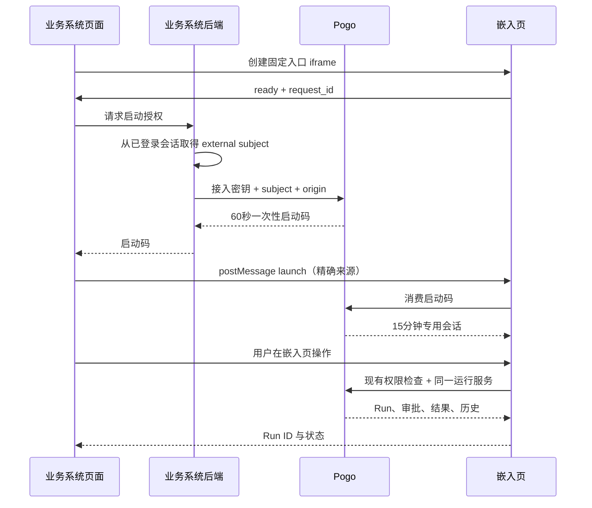

# 工作流嵌入其他系统

第二阶段在已发布版本之外增加 Publication（发布入口）。一个工作流可为多个业务系统创建不同入口，各自固定版本、配置来源网站、身份映射和接入密钥。原画布、发布指针、定时任务、账号和历史文件保持原路径与语义。

## 管理端配置

1. 启用本地账号，准备一个已有的普通用户，并配置它原有的工作流和 Run 权限。外部用户不能映射到运维管理员或空间管理员。
2. 在工作流页面发布版本，再打开“嵌入其他系统”。只有有发布与授权管理能力的空间管理员可以配置入口。
3. 填写入口名称、固定版本、允许嵌入的网站 origin、外部 subject 与平台用户名映射。来源采用精确的 `https://业务系统域名[:端口]`；本机开发允许 HTTP loopback，不支持通配符和 URL 路径。
4. 声明业务输入字段。节点任务和人工提示可引用 `{{ inputs.order_id }}`；用到的字段须声明为必填。输入属于单次 Run，不修改发布版本。
5. 保存后接入密钥只展示一次，交给业务系统的后端保存。需要替换时轮换密钥；停用入口、修改入口或轮换密钥都会使旧启动码和嵌入会话失效。

人工节点及 Agent 结果审批可配置禁止发起人自批，并自动按固定账号或业务后端名单分配节点权限；配置与 `approver_subjects` 换码字段见[审批策略与自动分配](workflow-approval-policy.md)。

旧账号的权限是最终授权依据。身份映射表示外部用户以该平台账号的身份在这个入口对应的工作流中操作，请按真实用户一对一映射。新入口默认“仅当前业务单”：后台换码必须提供 `business_id`，所有操作同时受发布入口、业务单和原权限限制。多个外部 subject 映射到同一平台账号时，仍会共享该账号在同一业务单内的授权范围。

旧入口缺少 `history_scope` 时保留原“该工作流全部授权记录”行为；管理员可明确切换到业务单模式。旧记录不自动猜测归属、不修改 Run ID，仍可从原管理页面按原权限查看。业务单隔离和可靠后台通知的细节见[业务单范围与后台回调](workflow-business-callback.md)。

## 接入链路



嵌入页使用专用 Bearer 会话，所有请求 `credentials: "omit"`，不依赖第三方登录 cookie，不读取平台长期令牌，不把会话放进 URL 或浏览器存储。浏览器可能限制第三方 cookie，因此采用独立会话传输。[浏览器存储访问说明](https://developer.mozilla.org/en-US/docs/Web/API/Storage_Access_API)

## 业务系统后端

后台调用下面的接口。`subject` 必须从业务系统自己已验证的登录会话取得，不能原样信任浏览器提交的用户名。接入密钥不能写入前端脚本、iframe 地址或日志。

```http
POST /api/workflow-embed/publications/{publication_id}/launch
Authorization: Bearer <后端保存的接入密钥>
Content-Type: application/json

{
  "subject": "业务系统登录用户的稳定标识",
  "origin": "https://business.example.com",
  "business_id": "ORDER-2026-001",
  "inputs": {"order_id": "ORDER-2026-001"}
}
```

返回 `launch_code`、`expires_at`、`embed_path`。需要打开已有 Run 时可传 `run_id`，仍检查该映射账号对该工作流和 Run 的权限。可预填部分输入，但不能传入入口未声明的字段；最终提交运行时校验必填项。

启动码只能消费一次，有效期 60 秒。不要缓存或重用。业务后端收到每次 iframe ready 请求后重新申请；Pogo 重启后，未消费的码和已有会话都失效，业务后端重新换码即可，不会因此创建新 Run。

## 业务系统页面

以下片段放在业务系统自己的页面。`/your-backend/pogo-launch` 是业务系统后端自建的接口，它执行上面的换码请求，只把一次性码交给前端。示例域名与入口 ID 需替换。

```html
<iframe id="pogo-workflow" title="业务办理"
  style="width:100%;height:760px;border:0"
  referrerpolicy="no-referrer"></iframe>
<script type="module">
const pogoOrigin = "https://pogo.example.com";
const publicationId = "pub_REPLACE_WITH_REAL_ID";
const frame = document.getElementById("pogo-workflow");
let generation = 0;
let selectedRun = new URL(location.href).searchParams.get("pogo_run");

window.addEventListener("message", async (event) => {
  if (event.origin !== pogoOrigin || event.source !== frame.contentWindow) return;
  const message = event.data;
  if (!message || message.protocol !== 1 || message.publication_id !== publicationId) return;
  if (message.type === "pogo.workflow.ready") {
    const current = ++generation;
    const response = await fetch("/your-backend/pogo-launch", {
      method: "POST", credentials: "same-origin",
      headers: {"Content-Type": "application/json"},
      // 后端自行确定已登录用户、允许的入口和业务单号。
      body: JSON.stringify({publication_id: publicationId, origin: location.origin, run_id: selectedRun})
    });
    if (!response.ok) return; // 在业务页提示授权失败，允许用户重新进入。
    const launch = await response.json();
    if (current !== generation) return;
    frame.contentWindow.postMessage({
      type: "pogo.workflow.launch", protocol: 1,
      publication_id: publicationId, request_id: message.request_id,
      code: launch.launch_code
    }, pogoOrigin);
  }
  if (message.type === "pogo.workflow.run") {
    // 生产系统可把 run_id 关联到业务单；这里只保存到宿主页地址以演示刷新恢复。
    selectedRun = message.run_id;
    const url = new URL(location.href);
    url.searchParams.set("pogo_run", selectedRun);
    history.replaceState(history.state, "", url);
  }
});
frame.src = `${pogoOrigin}/embed/workflows/${encodeURIComponent(publicationId)}`
  + `?parent_origin=${encodeURIComponent(location.origin)}`
  + (selectedRun ? `&run=${encodeURIComponent(selectedRun)}` : "");
</script>
```

父子页面都检查精确 origin、发送方 Window 与握手 request_id。状态消息只带入口 ID、Run ID 和状态，不携带业务输入、审批意见或产物。[postMessage 来源校验](https://developer.mozilla.org/en-US/docs/Web/API/Window/postMessage)

iframe 文档响应按入口返回 `Content-Security-Policy: frame-ancestors ...`，允许网站名单由 Pogo 管理端决定。业务系统自身若设置 CSP，也需在 `frame-src` 中允许 Pogo 地址；多层 iframe 的各级祖先都须在入口允许范围内。[frame-ancestors 说明](https://developer.mozilla.org/en-US/docs/Web/HTTP/Reference/Headers/Content-Security-Policy/frame-ancestors)

## 运行、权限与记录

- 嵌入页只提供业务输入、开始运行、历史、节点状态、审批、结果、取消和重试；不挂载编辑器或运维管理页。
- 启动使用入口绑定的版本，不随草稿编辑、原发布指针变动而移动。需要升级入口时由管理员明确修改版本。
- 每次专用 API 请求重新校验入口状态、配置代次、映射账号和原动作权限。Run 的读取、节点审批、产物、取消和重试沿用第一阶段规则，节点级主体不会看到根级完整输入。
- `history_scope: "business"` 时，只返回不可变运行目录中 `publication_id + workflow_id + business_id` 都匹配、且该账号有权查看的 Run。列表先隔离和授权，再分页；详情、审批、产物、取消、重试及带 `run_id` 换码同样检查。浏览器提交的业务号或 Run 的显示来源不能改变该范围。
- `history_scope: "workflow"` 是旧入口兼容模式，保留该账号在对应工作流中有权查看的历史；旧记录缺少业务归属时只在此模式或原管理页中按原权可见。
- 嵌入运行在原统一队列和记录中登记，保留 `publication_id`、`integration_id`、`external_subject`、`business_id`、`version_id` 和业务输入；原管理页面可查看同一 Run。
- 审批续跑沿同一 Run；失败或取消后的重试创建新 Run，保留原入口来源、输入和 `retry_of`。节点发起人、审批人仍以现有平台主体记录。
- 会话到期只结束页面访问，不取消后台 Run。重新打开/授权、刷新或续期都不会自动重复启动流程；运行必须由用户明确提交。
- 开始运行可传 `request_key` 或 `Idempotency-Key`。同账号、入口、请求键和输入返回同一 Run，改变输入时复用键返回冲突。
- 业务单模式的启动和重试幂等键包含业务范围；不同业务单使用相同请求键不会串单。
- 配置后台回调后，通知先持久入库，离开页面、会话到期或重启不依赖 iframe 保活。回调验签、失败重试、人工恢复和接收方去重见[回调协议](workflow-business-callback.md#后台回调协议)。

## API 概览

管理 API 沿用平台账号认证：

| 方法及路径 | 作用 |
| --- | --- |
| `GET /api/manage/workflows/{wid}/publications` | 入口列表与可映射普通账号 |
| `POST /api/manage/workflows/{wid}/publications` | 创建，返回入口与一次展示的接入密钥 |
| `PUT /api/manage/workflows/{wid}/publications/{pid}` | 带 `revision` 更新，含停用 |
| `POST .../{pid}/rotate-secret` | 轮换后台接入密钥 |

专用 API 前缀为 `/api/workflow-embed/publications/{pid}`：

| 方法及后缀 | 认证与作用 |
| --- | --- |
| `POST /launch` | 后台接入密钥换一次性码 |
| `POST /session` | `{code,parent_origin}` 消费码，返回 `session_token` |
| `GET /session` | 专用会话读取入口、身份、到期时间与可启动状态 |
| `GET /runs`、`GET /runs/{rid}` | 专用会话读取按原权限过滤的历史与状态 |
| `POST /runs` | `{inputs,request_key}` 从固定版本启动 |
| `POST /runs/{rid}/cancel`、`POST /runs/{rid}/retry` | 按原 Run 动作权限控制 |
| `POST /runs/{rid}/nodes/{nid}/resume` | `{action,fields}` 按原节点审批权限续跑 |
| `GET /runs/{rid}/nodes/{nid}/artifact` | 按原节点产物权限读取文字内容 |

Publication 存储在 `<SessionDir>/workflows/publications.json`，使用独立版本的原子文件写入。接入密钥只存摘要。启动码与短会话仅存于进程内存；不改旧发布文件、原账号哈希或历史 Run ID。仍不冻结所引用 Agent、Skill、MCP 的完整依赖，原工作流执行权限和运行时约束继续适用。

## 独立本地验收

`TestWorkflowUIFixtureServer` 在原隔离夹具基础上可增加一个独立业务网站。启动开发页面后，在 `pogo/` 中执行：

```sh
test_output=$(mktemp -d /private/tmp/pogo-workflow-ui.XXXXXX)
TMPDIR=/private/tmp POGO_WORKFLOW_UI_FIXTURE="$test_output" \
  POGO_WORKFLOW_UI_DEV=http://127.0.0.1:5179 POGO_WORKFLOW_UI_STAGE2=1 \
  go test ./web -run '^TestWorkflowUIFixtureServer$' -count=1 -timeout 50m -v
```

输出目录的 `fixture.json` 提供独立后端与业务网站地址，业务页面的 Alice/Bob 仅模拟测试登录。模型为本地脚本，数据与现有服务隔离。完成后关闭验收页签，向输出目录写入 `stop` 文件，让夹具正常退出并清理临时数据；不需要 Docker。

### 2026-10-27 验收结果

实际使用 Chrome 在不同本机端口的业务页面中操作跨来源 iframe，已验证：管理员创建入口、固定版本与输入、单次密钥展示与轮换、只读和节点审批授权、同 Run 续跑及产物、后台统一记录、取消与重试、入口停用、服务重启后重新授权恢复，以及宿主整页刷新后保持同 Run 且不重复启动。

完成记录 `run_ACMBGVJ5UHFC4V3Y67CFLALZ6T` 由 Alice 在嵌入页启动，Bob 获节点审批权后处理并续跑完成；同一 Run 两个执行段。取消后的新 Run 保留原输入、发布入口、业务单号和 `retry_of`。宿主刷新验证记录为 `run_3V3R2H4I3GDYO3KWVKXYKNOI3W`，刷新前后运行总数均为 1，最终 completed。

相关后端测试通过，工作流引擎测试通过；11 个前端测试文件共 103 项、类型检查与 `git diff --check` 通过。所有夹具正常退出，测试端口和临时数据已清理。截图及无凭据运行证据保存在工作区 `.ci-artifacts/workflow-stage2-ui-cxnIz7/`（不纳入 Git）。本次不包含真实业务系统登录联调、真实模型业务验收、静态产物发布或 Docker 部署。
