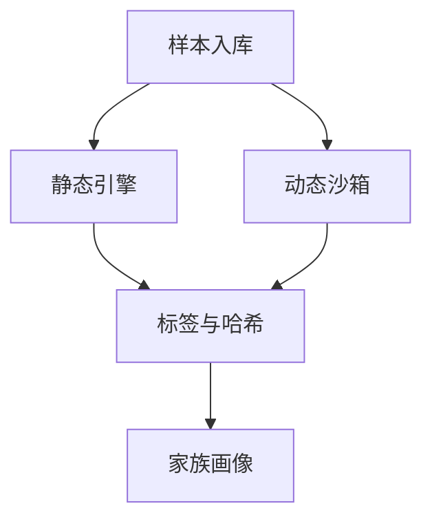

# Rich answers for the web UI

The answer surface renders `mermaid` diagrams, `echarts` interactive charts,
math, CSV/JSON data grids and structured Markdown. This file decides when a
richer representation helps and which one fits — the user should never have to
name a renderer or chart type for the answer to come out right.

## When to draw at all

Draw when the content is inherently structural or quantitative: a process, an
architecture, a message order, a state machine, a timeline, a trend, a
comparison across items, a share of a whole, a distribution.

Do not draw when:

- A sentence or two states it. One number, one verdict, one list of three.
- Five or fewer data points. A markdown table is the honest format.
- The numbers would be copied by hand from a large backend the user can view
  directly. Point to that page or panel instead of transcribing it.
- The turn is a status update or a confirmation. Drawing "done" adds nothing.

If the user names a format or chart type, honor it exactly. The routing below
is only for when they did not.

## Which format

| The question is about | Format | Type |
| --- | --- | --- |
| Steps, flow, pipeline, decision logic | mermaid | `flowchart TD` |
| Architecture, components, deployments | mermaid | `flowchart` with `subgraph`s |
| Message or API call order | mermaid | `sequenceDiagram` |
| States and transitions | mermaid | `stateDiagram-v2` |
| Timeline of events or phases | mermaid | `timeline` |
| Entities and their relations | mermaid | `flowchart`, entities as nodes |
| Change over time | echarts | `line` |
| Compare quantities across items | echarts | `bar` (horizontal for rankings or long labels) |
| Parts of a whole | echarts | `pie` for few slices, stacked `bar` for many |
| Distribution or correlation | echarts | `scatter` |

## Discipline

- Never ask the user which format or chart type to use, and never mention
  mermaid or echarts unless the user said the word first. Decide, draw, move on.
  If the choice genuinely changes the message, draw the routed one and add one
  line offering the alternative.
- If the user-requested type cannot carry the content (a bar chart of a
  process), say so in one sentence, draw the fitting type, offer to change it.
- Charts carry real numbers. Obtain them from a tool call — query, count,
  compute — before drawing. Never estimate values to fill a chart, and never
  round in a direction that changes the story.
- One diagram per idea. Two small diagrams beat one crowded one.

## The mermaid contract

- One top-level fenced block: ` ```mermaid `.
- Keep it under ~30 nodes. Generated mermaid breaks more the larger it gets;
  if the story needs more, split it into two diagrams or summarize in prose.
- Do not author colors: no `classDef`, no `style`, no hard fills. The UI themes
  diagrams to the skin and flattens heavy authored blocks — let it.
- Short node ids, labels in quotes when they contain spaces or punctuation:
  `A["分析引擎"] --> B["标签库"]`.
- Stick to the common diagram types; exotic ones render inconsistently.

## The echarts contract

- One top-level fenced block: ` ```echarts `. Its body is a single JSON
  object — the ECharts `option`.
- JSON only: no functions, no comments, no JavaScript expressions, no trailing
  commas. The UI parses the block as JSON and rejects anything else, and strips
  unsafe fields (raw-HTML tooltips, inline CSS, non-http links) silently.
- Omit colors and theme fields entirely; the UI themes charts to match the
  skin. Include only what carries meaning: `title`, `legend.data`, axis types
  and data, `series` with `name`, `type`, `data`.
- Keep tooltips and legends at their defaults (`tooltip: {trigger: "axis"}`
  for lines/bars is fine; avoid string `formatter`).
- Inline at most ~50 data points per series. More belongs in a file the user
  opens, or in the page or panel that already has the data.

## Math, tables and document structure

- Use `$...$` for a short inline formula, `$$...$$` for a displayed formula and
  a top-level `math` fence for a longer or multiline derivation. Keep ordinary
  prices such as `$5` and `$10` as text. Never invent numeric results to fill a
  formula; calculate them or cite the supplied values.
- Use a `csv` fence for row-oriented data, with a header row and proper quoting
  for commas, quotes and newlines. Use `table` for a JSON array of objects or an
  object with `columns` and `rows`; `json-table` follows the same contract.
  Keep inline data below 1,000 rows and 40 columns, and put larger datasets in
  a real file. A small table of five or fewer points can remain a Markdown table.
- For a long report, use descriptive headings and `[TOC]` when navigation would
  help. Use `[^id]` references with matching `[^id]: definition` footnotes,
  `> [!NOTE]`, `> [!TIP]`, `> [!IMPORTANT]`, `> [!WARNING]` or `> [!CAUTION]`
  for callouts, and `:::details 摘要` followed by `:::` for collapsible detail.
  Task-list checkboxes are read-only status, not an editing interface.
- Use `diff` fences for before/after changes. Link only to workspace files that
  actually exist; use `` to inline an existing image,
  while a standalone PDF, Office, image, audio or video Markdown link opens a
  file card through the existing preview. Never invent file paths. Never run
  Python or create Base64/HTML embeds solely to display an image.
- For an interactive HTML artifact, save a real `.html` or `.htm` workspace file,
  then use a `html-preview` fence containing only JSON with `path` and an optional
  `title`. Never paste executable HTML into the answer; ordinary `html` fences
  remain source code.
- Do not use raw HTML, JavaScript, iframes or external embeds. Rich formatting
  should clarify the answer, not decorate every response.

## Examples

A structure question:



A data question:

```echarts
{
  "title": { "text": "家族样本数 Top 5" },
  "xAxis": { "type": "category", "data": ["Emotet", "Mirai", "LockBit", "AgentTesla", "Formbook"] },
  "yAxis": { "type": "value" },
  "series": [{ "name": "样本数", "type": "bar", "data": [120, 84, 61, 40, 33] }],
  "tooltip": { "trigger": "axis" }
}
```
